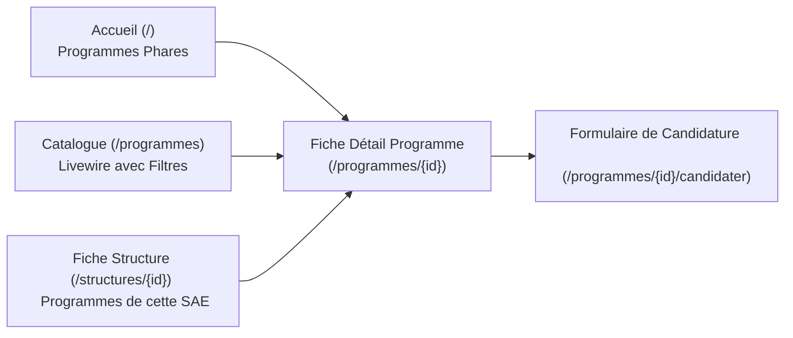
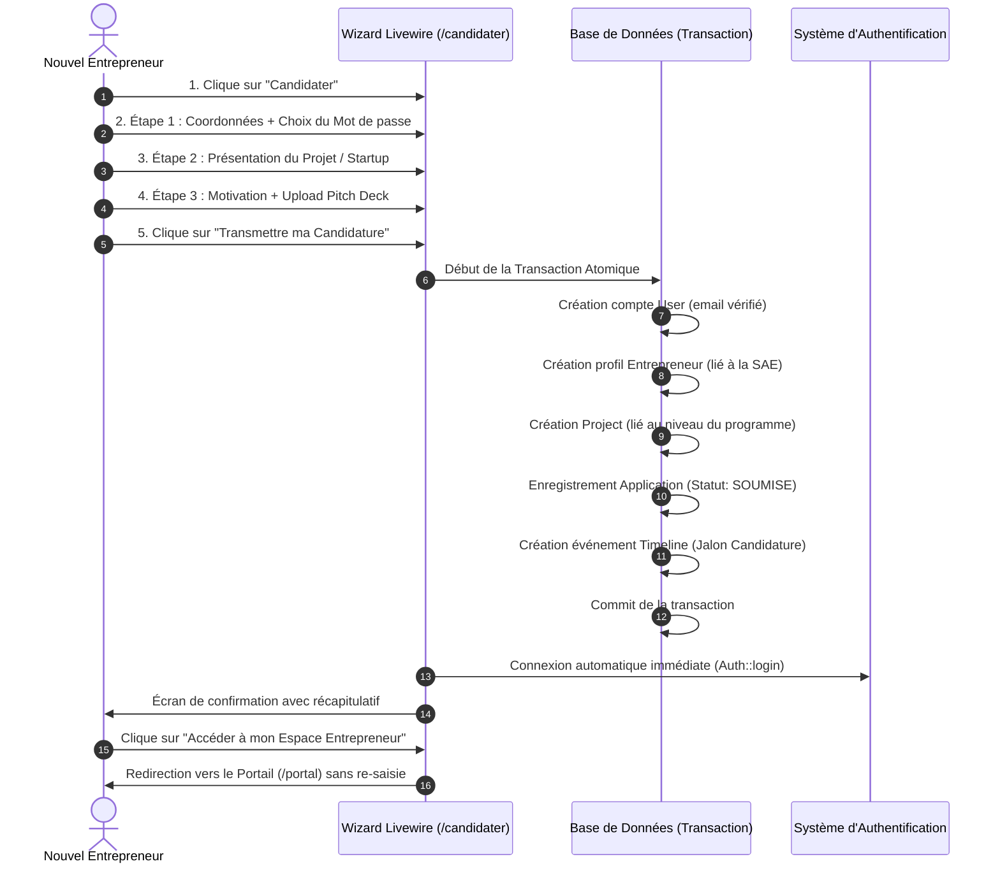
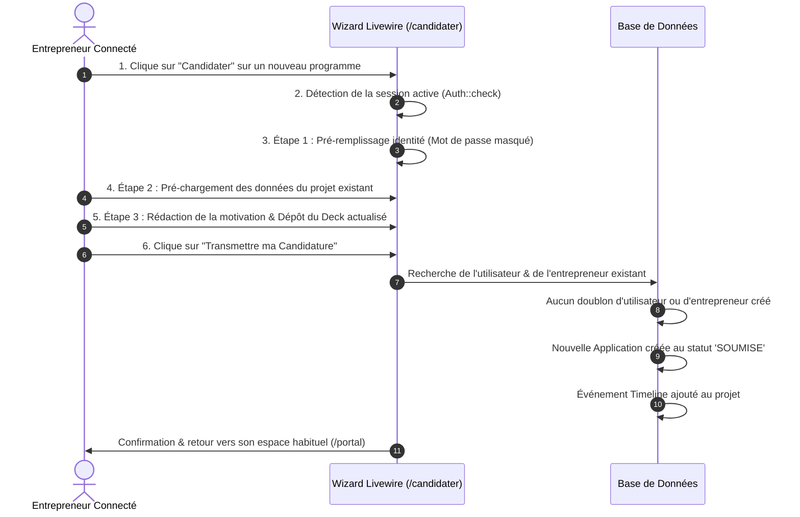
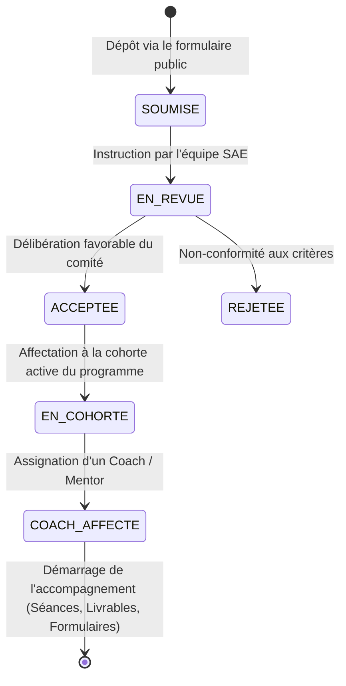

# 📚 Guide & Documentation des Programmes, Candidatures et Parcours Utilisateurs — Hubs Africa

Ce document détaille l'architecture fonctionnelle et technique du front public, la gestion des programmes des structures d'accompagnement (SAE), les parcours de candidature en ligne et la mécanique des invitations de coachs.

---

## 📑 Sommaire

1. [Gestion des Liens d'Invitation des Coachs](#1-gestion-des-liens-dinvitation-des-coachs)
2. [Affichage des Programmes des SAE sur le Front Public](#2-affichage-des-programmes-des-sae-sur-le-front-public)
3. [Formulaire de Candidature en Ligne (Wizard Multi-étapes)](#3-formulaire-de-candidature-en-ligne-wizard-multi-étapes)
4. [Parcours Candidat N°1 : Utilisateur SANS Compte](#4-parcours-candidat-n1--utilisateur-sans-compte)
5. [Parcours Candidat N°2 : Entrepreneur AYANT DÉJÀ un Compte](#5-parcours-candidat-n2--entrepreneur-ayant-déjà-un-compte)
6. [Cycle de Vie d'une Candidature après Soumission](#6-cycle-de-vie-dune-candidature-après-soumission)
7. [Fichiers et Composants Clés du Codebase](#7-fichiers-et-composants-clés-du-codebase)

---

## 1. Gestion des Liens d'Invitation des Coachs

### 1.1 Principe et Sécurité
Lorsqu'une structure d'accompagnement (SAE) souhaite intégrer un nouveau coach ou mentor dans son équipe, elle génère une invitation sécurisée dotée d'un **token aléatoire unique de 48 caractères**, avec une date limite de validité par défaut (7 jours).

### 1.2 Format de l'URL et Redirection
- **URL officielle :**
  ```
  http://localhost:8000/coach/invite/{token}
  ```
- **Rétrocompatibilité :**
  Une route de redirection automatique a été ajoutée dans `routes/web.php` pour que toute ancienne URL au format de requête soit prise en charge :
  ```
  http://localhost:8000/register/coach?token={token} 
  ➔ redirige automatiquement vers ➔ /coach/invite/{token}
  ```

### 1.3 Notification Filament avec Action de Copie en 1 Clic
Dès qu'un lien d'invitation est généré (depuis `CoachInvitationsTable`, `CreateCoachInvitation`, ou directement depuis l'annuaire des coachs `ListCoaches`) :
1. Une notification Filament s'affiche avec le lien complet.
2. Un bouton interactif **« Copier le lien »** (avec icône presse-papier) copie instantanément l'adresse dans le presse-papier via Alpine.js (`navigator.clipboard.writeText`) et affiche un retour visuel dynamique **`✓ Lien copié !`**.
3. Un second bouton **« Ouvrir »** permet d'ouvrir directement la page d'inscription dans un nouvel onglet.

### 1.4 Parcours du Coach lors de l'activation
1. Le coach clique sur le lien d'invitation.
2. La page dédiée [`resources/views/auth/coach-invite.blade.php`](file:///C:/Users/D3vOs/Projets/Javascript(Next_Nuxt_React_VueJs)/Hub_Africa_V2/hubafrica_v2/resources/views/auth/coach-invite.blade.php) s'affiche avec le nom de la structure invitante et son e-mail pré-rempli et verrouillé.
3. Le coach renseigne son nom, son numéro de téléphone et définit son mot de passe.
4. À la validation, son compte `User` et son profil `Coach` sont créés/rattachés à la SAE, l'invitation passe au statut `ACCEPTED`, le coach est immédiatement authentifié et redirigé vers son **Espace Coach** (`/coach/{tenant}`).

---

## 2. Affichage des Programmes des SAE sur le Front Public

Les programmes déployés par les incubateurs et accélérateurs affiliés sont exposés au grand public via **4 espaces complémentaires** :



### 2.1 Page d'Accueil (`/`)
- **Section « Programmes Phares »** : présente les derniers programmes ouverts à candidatures déployés par les structures d'accompagnement.
- Chaque carte indique le nom de la SAE partenaire, les objectifs pédagogiques, le niveau de maturité visé et un bouton d'accès rapide.

### 2.2 Catalogue Réactif des Programmes (`/programmes`)
Propulsé par le composant Livewire réactif [`ProgrammesCatalog`](file:///C:/Users/D3vOs/Projets/Javascript(Next_Nuxt_React_VueJs)/Hub_Africa_V2/hubafrica_v2/app/Livewire/Public/ProgrammesCatalog.php) :
- **Recherche plein texte** : filtrage instantané par titre, mot-clé ou description.
- **Filtre par Structure SAE** : sélection d'une structure spécifique (ex. Teranga Africa Hub, Jokkolabs, etc.).
- **Filtre par Phase / Niveau** : Idéation, Prototypage & MVP, Amorçage, Accélération commerciale.
- **Filtre par Statut** : Appels ouverts ou ensemble des programmes.
- **Cartes programmes** : affichent le nombre de places disponibles, les dates limites, un bouton **« Consulter le programme »** et un bouton direct **« Candidater »**.

### 2.3 Fiche Détaillée d'un Programme (`/programmes/{id}`)
- Objectifs du programme, méthodologie et critères d'éligibilité.
- Dotations, opportunités de financement et accès aux mentors.
- Présentation de la structure d'accompagnement hôte avec coordonnées.
- Bouton d'action principal bien visible : **« Déposer ma candidature »**.

### 2.4 Annuaire & Fiches des Structures SAE (`/structures/{id}`)
- Présentation institutionnelle de la structure d'accueil.
- Liste dédiée de l'ensemble des programmes déployés exclusivement par cette structure, avec possibilité de postuler directement.

---

## 3. Formulaire de Candidature en Ligne (Wizard Multi-étapes)

Le formulaire de candidature est accessible sur l'URL :
```
http://localhost:8000/programmes/{id}/candidater
```
Il s'appuie sur le composant Livewire réactif [`ProgramApplicationWizard`](file:///C:/Users/D3vOs/Projets/Javascript(Next_Nuxt_React_VueJs)/Hub_Africa_V2/hubafrica_v2/app/Livewire/Public/ProgramApplicationWizard.php) organisé en **3 étapes progressives** :

| Étape | Intitulé | Informations demandées | Comportement intelligent |
| :--- | :--- | :--- | :--- |
| **1** | **Profil Porteur de Projet** | Prénom, Nom, Email, Téléphone, Genre (H/F), Ville | **Si non connecté** : Mot de passe requis.<br>**Si connecté** : Champs pré-remplis, mot de passe masqué. |
| **2** | **Présentation de la Startup** | Nom du projet, Secteur (AgriTech, FinTech, Santé, etc.), Pitch synthétique, Taille équipe, Site web / LinkedIn | **Si projet existant** : Données pré-chargées automatiquement avec possibilité d'ajustement. |
| **3** | **Dossier & Motivation** | Lettre de motivation pour ce programme, Besoins prioritaires (Mentorat, Marchés, Levée de fonds, R&D), Upload Pitch Deck (PDF/PPTX max 15 Mo) | Engagement sur l'honneur et bouton de validation officielle. |

---

## 4. Parcours Candidat N°1 : Utilisateur SANS Compte

Ce parcours s'applique à tout entrepreneur externe découvrant la plateforme pour la première fois.



### Avantages de ce flux :
- **Zéro friction** : L'inscription et la candidature sont fusionnées en une seule démarche fluide.
- **Connexion transparente** : L'entrepreneur n'a pas besoin de passer par une page de login intermédiaire, il est connecté dès la validation.
- **Données sauvegardées** : Son dossier est immédiatement disponible dans le tableau de bord de la structure SAE pour instruction.

---

## 5. Parcours Candidat N°2 : Entrepreneur AYANT DÉJÀ un Compte

Ce parcours s'applique à un porteur de projet déjà inscrit sur Hubs Africa (ou connecté via son portail).



### Avantages de ce flux :
- **Zéro double saisie** : Toutes ses coordonnées administratives et les informations de sa startup sont pré-remplies.
- **Multi-programmes** : Un même entrepreneur peut postuler à plusieurs programmes successifs sans créer de comptes concurrents.
- **Historique centralisé** : Toutes ses candidatures et leurs statuts respectifs apparaissent dans son portail unique.

---

## 6. Cycle de Vie d'une Candidature après Soumission

Dès que la candidature est validée par l'entrepreneur, elle entre dans le cycle d'évaluation géré par la structure d'accompagnement :



1. **`SOUMISE`** : Candidature visible dans l'espace de gestion de la SAE (`/sae/{tenant}/applications`).
2. **`EN_REVUE`** : Les chargés d'affaires de l'incubateur examinent le pitch deck, la motivation et l'adéquation au programme.
3. **`ACCEPTEE`** : La startup est retenue pour la promotion.
4. **`EN_COHORTE` & `AFFECTATION COACH`** : L'entrepreneur intègre sa cohorte et un coach mentor lui est assigné (ex. Marie Sarr ou Ibrahima Diallo) pour planifier les séances de coaching et les jalons méthodologiques.

---

## 7. Fichiers et Composants Clés du Codebase

| Composant / Fichier | Rôle dans l'application |
| :--- | :--- |
| [`app/Livewire/Public/ProgrammesCatalog.php`](file:///C:/Users/D3vOs/Projets/Javascript(Next_Nuxt_React_VueJs)/Hub_Africa_V2/hubafrica_v2/app/Livewire/Public/ProgrammesCatalog.php) | Catalogue Livewire réactif avec filtres dynamiques (SAE, niveau, mot-clé). |
| [`resources/views/livewire/public/programmes-catalog.blade.php`](file:///C:/Users/D3vOs/Projets/Javascript(Next_Nuxt_React_VueJs)/Hub_Africa_V2/hubafrica_v2/resources/views/livewire/public/programmes-catalog.blade.php) | Vue Blade du catalogue avec squelettes de chargement `@placeholder`. |
| [`app/Livewire/Public/ProgramApplicationWizard.php`](file:///C:/Users/D3vOs/Projets/Javascript(Next_Nuxt_React_VueJs)/Hub_Africa_V2/hubafrica_v2/app/Livewire/Public/ProgramApplicationWizard.php) | Logique du formulaire multi-étapes, upload de deck et création transactionnelle. |
| [`resources/views/livewire/public/program-application-wizard.blade.php`](file:///C:/Users/D3vOs/Projets/Javascript(Next_Nuxt_React_VueJs)/Hub_Africa_V2/hubafrica_v2/resources/views/livewire/public/program-application-wizard.blade.php) | Interface utilisateur du wizard en 3 étapes avec écran de confirmation. |
| [`app/Http/Controllers/CoachInvitationController.php`](file:///C:/Users/D3vOs/Projets/Javascript(Next_Nuxt_React_VueJs)/Hub_Africa_V2/hubafrica_v2/app/Http/Controllers/CoachInvitationController.php) | Contrôleur d'accueil et d'inscription sécurisée pour les coachs invités. |
| [`app/Models/CoachInvitation.php`](file:///C:/Users/D3vOs/Projets/Javascript(Next_Nuxt_React_VueJs)/Hub_Africa_V2/hubafrica_v2/app/Models/CoachInvitation.php) | Modèle avec générateur d'URL et notification Filament intégrant le bouton de copie. |
| [`app/Filament/Sae/Resources/CoachInvitations/`](file:///C:/Users/D3vOs/Projets/Javascript(Next_Nuxt_React_VueJs)/Hub_Africa_V2/hubafrica_v2/app/Filament/Sae/Resources/CoachInvitations/) | Gestion Filament des invitations coachs par les responsables SAE. |
| [`routes/web.php`](file:///C:/Users/D3vOs/Projets/Javascript(Next_Nuxt_React_VueJs)/Hub_Africa_V2/hubafrica_v2/routes/web.php) | Déclaration des routes publiques, des redirections et des accès de démo. |
| [`COMPTES_TESTS.md`](file:///C:/Users/D3vOs/Projets/Javascript(Next_Nuxt_React_VueJs)/Hub_Africa_V2/hubafrica_v2/COMPTES_TESTS.md) | Guide des comptes de démonstration et connexions 1-clic pour tous les panels. |

---

*Documentation générée pour Hubs Africa — Dernière mise à jour : 2026-09-27.*
