# 📚 Guide Pratique & Manuel d'Utilisation : Plateforme d'Accompagnement Hub Africa V2

> **Espace Responsable SAE, Équipe Pédagogique & Jurys d'Admission**  
> Ce manuel documente de manière exhaustive l'organisation de la plateforme par **Clusters Filament**, détaille les actions réalisables par les responsables et illustre le cycle complet d'accompagnement à travers le cas pratique réel de la startup **« BioAgri Tech »**.

---

## 📑 Sommaire Général

1. [Nouvelle Architecture & Organisation par Clusters](#1-nouvelle-architecture--organisation-par-clusters)
2. [Cas Pratique Fil Rouge : Accompagnement de « BioAgri Tech » de A à Z](#2-cas-pratique-fil-rouge--accompagnement-de-bioagri-tech-de-a-à-z)
   - [Étape 1 : Conception du Programme & Cadrage Pédagogique](#étape-1--conception-du-programme-accélération-agritech-2026)
   - [Étape 2 : Lancement de la Cohorte & Synchronisation des Jalons](#étape-2--création-de-la-cohorte-agritech-promo-1--synchronisation-des-jalons)
   - [Étape 3 : Réception de Candidature & Notation Pondérée par le Jury](#étape-3--candidature-de-bioagri-tech--notation-matricielle-du-jury)
   - [Étape 4 : Intégration au Portefeuille & Affectation du Mentor](#étape-4--intégration-au-portefeuille--affectation-du-coach-référent)
   - [Étape 5 : Séances de Coaching & Ateliers avec Émargement](#étape-5--séances-de-coaching-ateliers-collectifs--émargement)
   - [Étape 6 : Dépôt de Livrables & Versionnage GED Polymorphe](#étape-6--dépôt-du-livrable-révision--ged-polymorphe-versionnée)
   - [Étape 7 : Mesure d'Impact (KPI), Financements & Data Room](#étape-7--mesure-dimpact-kpi-financement-décaissé--coffre-data-room)
   - [Étape 8 : Enquête Bilan, Centre d'Analyse & Reporting Bailleurs](#étape-8--enquête-bilan-centre-danalyse--rapport-dimpact-pour-le-bailleur)
3. [Répertoire Exhaustif des Actions par Cluster](#3-répertoire-exhaustif-des-actions-par-cluster)
   - [Cluster 1 : Programmes & Sélection](#cluster-1--programmes--sélection)
   - [Cluster 2 : Portefeuille Startups](#cluster-2--portefeuille-startups)
   - [Cluster 3 : Accompagnement & Mentorat](#cluster-3--accompagnement--mentorat)
   - [Cluster 4 : Impact, Finance & Évaluation](#cluster-4--impact-finance--évaluation)
   - [Module Transverse : Pilotage & Décision](#module-transverse--pilotage--décision)
4. [Index des Emplacements de Captures d'Écran](#4-index-des-emplacements-de-captures-décran)

---

## 1. Nouvelle Architecture & Organisation par Clusters

Afin de fluidifier le travail des équipes d'incubation et d'accélération, les ressources du panel SAE (`/sae/{tenant}`) sont regroupées en **4 Clusters Métiers** et un **Groupe de Pilotage** :

```mermaid
flowchart TD
    subgraph C1["🎓 1. Programmes & Sélection"]
        direction TB
        P1["Programmes & Jalons modèles"]
        P2["Cohortes & Promotions"]
        P3["Jalons & Phases (Nouveau menu direct)"]
        P4["Candidatures & Scoring Jury"]
        P5["Partenaires & Bailleurs"]
        P6["Niveaux de maturité"]
    end

    subgraph C2["💼 2. Portefeuille Startups"]
        direction TB
        S1["Projets (Fiche 360°)"]
        S2["Entrepreneurs & Fondateurs"]
        S3["Journal chronologique (Timeline)"]
    end

    subgraph C3["👥 3. Accompagnement & Mentorat"]
        direction TB
        A1["Séances & Ateliers"]
        A2["Coachs & Capacité max"]
        A3["Invitations sécurisées"]
        A4["Livrables soumis & GED"]
        A5["Livrables attendus"]
        A6["Ressources pédagogiques"]
        A7["Calendrier mensuel"]
    end

    subgraph C4["📊 4. Impact, Finance & Évaluation"]
        direction TB
        I1["Indicateurs S&E (KPI)"]
        I2["Financements & Subventions"]
        I3["Data Room documentaire"]
        I4["Formulaires & Enquêtes"]
    end

    subgraph PL["🎯 Pilotage & Décision"]
        direction TB
        PL1["Tableau de bord"]
        PL2["Centre d'analyse"]
        PL3["Rapports & Exports Bailleurs"]
        PL4["Journal d'audit"]
        PL5["Guide d'utilisation SAE"]
    end
```

---

## 2. Cas Pratique Fil Rouge : Accompagnement de « BioAgri Tech » de A à Z

Pour illustrer concrètement le fonctionnement de la plateforme, ce cas pratique décrit le parcours complet de la startup **BioAgri Tech SARL**.

### Fiche d'Identité du Cas
- **Startup :** BioAgri Tech SARL (Solution IoT de fertilisation biologique pour l'agriculture vivrière).
- **Fondateur :** Amadou Traoré (28 ans, diplômé d'agronomie, basé à Korhogo).
- **Coach Référent :** Dr. Koffi N'Guessan (Expert Agri-business & Modèles économiques ruraux).
- **Bailleurs Partenaires :** Fonds Ouest-Africain pour l'AgriTech (FOA) & AFD.
- **Programme :** Accélération AgriTech 2026 (Cohorte Promo 1).

---

### Étape 1 : Conception du Programme « Accélération AgriTech 2026 »

**Menu :** `Programmes & Sélection > Programmes` (`/sae/{tenant}/programmes/programs`)

#### Actions du Responsable SAE :
1. Cliquer sur **« Nouveau programme »** et renseigner le titre *« Accélération AgriTech 2026 »*, les objectifs et la description.
2. Ouvrir l'onglet **« Phases & Jalons pédagogiques »** et structurer les 4 étapes :
   - *Phase 1 : Diagnostic & Boot Camp* (Durée : 4 semaines | Ordre : 1).
   - *Phase 2 : Structuration MVP & Business Plan* (Durée : 8 semaines | Ordre : 2).
   - *Phase 3 : Validation Marché & Traction* (Durée : 8 semaines | Ordre : 3).
   - *Phase 4 : Demo Day & Levée de fonds* (Durée : 4 semaines | Ordre : 4).
3. Ouvrir l'onglet **« Grille de sélection & Critères Jury »** pour paramétrer la matrice de notation :
   - *Innovation & Scalabilité* (Coefficient : 3 | Barème : /20).
   - *Qualité & Complémentarité de l'équipe* (Coefficient : 2 | Barème : /20).
   - *Impact Environnemental & RSE* (Coefficient : 2 | Barème : /20).
   - *Faisabilité Financière* (Coefficient : 1 | Barème : /20).
4. Ouvrir l'onglet **« Partenaires & Bailleurs associés »** : cliquer sur **« Associer un partenaire »**, choisir l'institution dans le sélecteur, préciser son rôle (*Bailleur Principal*) et sa contribution financière (*45 000 000 FCFA*).

> 📸 **[CAPTURE D'ÉCRAN N°1 : Édition du Programme avec ses onglets combinés (Phases, Critères, Bailleurs)]**  
> - **Emplacement suggéré :** `docs/images/guide/01-program-setup.png`  
> - **Résolution recommandée :** 1440 &times; 850 px  
> - **Ce qui doit être visible :** La page d'édition du programme avec les onglets au sommet, les 4 phases ordonnées, la liste des critères pondérés et le bailleur FOA rattaché.

---

### Étape 2 : Création de la Cohorte « AgriTech Promo 1 », Synchronisation des Jalons & Projection Calendrier

**Menus :**  
- `Programmes & Sélection > Cohortes` (`/sae/{tenant}/programmes/cohorts`)  
- `Programmes & Sélection > Jalons & Phases` (`/sae/{tenant}/programmes/cohort-phases`)  
- `Accompagnement & Mentorat > Calendrier & Planning global` (`/sae/{tenant}/accompagnement/coaching-calendar-page`)

#### Actions du Responsable SAE :
1. Créer la cohorte **« AgriTech Promo 1 (2026) »**, rattachée au programme, avec une date de démarrage fixée au **01/10/2026**.
2. **Choix Obligatoire du Modèle de Candidature :**
   Chaque création de cohorte impose la sélection d'un formulaire de dossier de candidature (`application_form_id`). Le responsable peut conserver le **Modèle Standard Hub Africa** (socle commun panafricain à 13 champs pré-sélectionné par défaut) ou choisir un **Template Sur-Mesure** créé par la SAE avec ses questions complémentaires.
3. À l'enregistrement, la plateforme bascule immédiatement sur les onglets de la promotion.
4. Dans l'onglet **« Jalons réels & Calendrier de la cohorte »** (situé au sommet de la page) ou depuis le menu direct **« Jalons & Phases »**, cliquer sur le bouton d'action **« Synchroniser depuis le programme »**.
5. **Automatisation 1-Clic :** La plateforme calcule immédiatement les dates calendaires de chaque phase :
   - *Phase 1 :* 01/10/2026 au 28/10/2026.
   - *Phase 2 :* 29/10/2026 au 23/12/2026.
   - *Phase 3 :* 24/12/2026 au 17/02/2027.
   - *Phase 4 :* 18/02/2027 au 17/03/2027.
6. **Projection Immédiate sur le Calendrier Global :**  
   Toutes les dates d'ouverture (`starts_on`) et d'échéance (`ends_on`) des jalons ainsi que le lancement officiel de la promotion apparaissent automatiquement sur le **Calendrier Global**, permettant à toute l'équipe (responsables, mentors, jurys) d'avoir une visibilité transverse en temps réel.
7. **Génération du Lien Direct de Candidature (1-Clic) :**  
   Depuis le tableau des cohortes ou en tête de la page d'édition, le responsable clique sur l'action **« Lien direct »**. Une modale affiche l'URL unique (`/cohortes/{id}/rejoindre`) avec un bouton de copie instantanée dans le presse-papier. Ce lien peut être diffusé directement par email, WhatsApp ou réseaux sociaux aux entrepreneurs ciblés.
8. **Passerelle Candidat & Parcours Utilisateur Fluide :**  
   - **Nouveaux candidats sans compte :** Renseignent un formulaire express (prénom, nom, email, téléphone, mot de passe) ; leur compte et profil entrepreneur sont immédiatement créés, rattachés à la structure, et ils sont automatiquement connectés puis redirigés vers le formulaire de candidature de cette cohorte.
   - **Candidats déjà inscrits :** Sont invités à s'authentifier directement via le formulaire de connexion sur la même page, puis sont redirigés vers le formulaire pré-verrouillé sur la promotion.
   - **Candidats déjà connectés :** Sont instantanément redirigés vers le formulaire de candidature de la cohorte ciblée sans aucune friction.
   - **Questions Spécifiques SAE (Étape 3) :** Si la cohorte utilise un template personnalisé, les questions additionnelles créées par la SAE (textes, listes, cases à cocher) sont dynamiquement générées dans un bloc dédié avec validation en temps réel.
   - **Visibilité sur le Catalogue Public :** Tout programme disposant d'une promotion au statut `OUVERTE` arbore un badge `🟢 Cohorte Ouverte : [Nom]` et oriente le bouton d'action directement vers `Rejoindre cohorte →`.
9. **Extraction de la Matrice des Présences (Excel) :**  
   L'action **« Présences Excel »** permet au responsable et aux coachs d'extraire à tout moment un tableur complet croisant toutes les startups et l'ensemble des séances de coaching de la promotion, avec calcul automatique du taux d'assiduité.

> 📸 **[CAPTURE D'ÉCRAN N°2 : Cohorte créée, lien direct généré, onglet Jalons réels et projection sur le calendrier global]**  
> - **Emplacement suggéré :** `docs/images/guide/02-cohort-sync.png`  
> - **Résolution recommandée :** 1440 &times; 700 px  
> - **Ce qui doit être visible :** La fiche de la cohorte avec le bouton d'action « Lien direct », la modale de partage du lien, le tableau des phases calculées et les pastilles d'échéances sur le calendrier.

---

### Étape 3 : Candidature de « BioAgri Tech », Vue Unifiée & Notation Matricielle du Jury

**Menus :**
- Responsable SAE : `Programmes & Sélection > Candidatures` (`/sae/{tenant}/programmes/applications`)
- Membre du Jury / Coach : `Candidatures & Jurys` (`/coach/{tenant}/applications`)
- Porteur de projet : `Candidatures` (`/entrepreneur/applications`)

#### Actions du Responsable & des Jurys :
1. La candidature de la startup **BioAgri Tech** (portée par Amadou Traoré) est reçue sur la plateforme. Le modèle de formulaire utilisé est immédiatement identifié par un badge (`Dossier Standard Hub Africa` ou template spécifique de la SAE).
2. **Nouvelle Vue Unifiée Haute Fidélité :**
   En ouvrant le dossier, le responsable et les membres du jury accèdent à une page d'instruction complète et harmonisée :
   - **Bannière d'en-tête dynamique :** arborant la couleur du statut (`SOUMISE`, `EN_EXAMEN`, `ACCEPTEE`, `EN_ATTENTE`, `REFUSEE`) et la note consolidée du jury sur 100 avec coloration conditionnelle ($\ge 75$ vert, $50-74$ orange, $< 50$ rouge).
   - **Stepper visuel à 4 jalons :** *1. Soumission*, *2. Éligibilité*, *3. Jury*, *4. Délibération*.
   - **Boutons d'action rapide d'en-tête (SAE & Jury) :**
     - 🎓 **« Noter le dossier »** : ouvre la grille multicritères pondérée.
     - 🏆 **« Accepter »** : validation d'admission immédiate et enrôlement direct dans la cohorte.
     - ⏳ **« Mettre en attente »** : placement en liste de réserve.
     - ❌ **« Refuser »** : rejet formel avec saisie obligatoire d'un motif explicatif.
     - 💡 **« Fiche Projet »** : accès 1-clic à la fiche 360° de la startup.
   - **Questionnaire & GED :** affichage structuré des motivations, besoins prioritaires, réponses au questionnaire spécifique SAE et pièces jointes téléchargeables.
3. **Espace Dédié pour les Coachs / Jurys :**
   Les experts et mentors disposent de leur propre menu **« Candidatures & Jurys »** (`/coach/{tenant}/applications`) leur permettant d'examiner les dossiers qui leur sont confiés et d'enregistrer leurs notes et observations sans accéder aux fonctions d'administration SAE.
4. Les membres du jury cliquent sur l'action **« Noter »** (dans la table ou depuis le bandeau d'en-tête).
5. La modale interactive charge la grille du programme :
   - *Innovation & Scalabilité (x3) :* 17 / 20
   - *Qualité de l'équipe (x2) :* 18 / 20
   - *Impact environnemental (x2) :* 19 / 20
   - *Faisabilité financière (x1) :* 15 / 20
6. **Calcul Automatique & Décision Intelligente :** Le système calcule automatiquement la note normalisée sur 100 et applique les règles de délibération de la plateforme :
   $$\text{Score} = \frac{(17 \times 3) + (18 \times 2) + (19 \times 2) + (15 \times 1)}{(20 \times 8)} \times 100 = \frac{140}{160} \times 100 = \mathbf{87,5 / 100}$$
   - **Bascule Automatique du Statut selon la Note :**
     - **≥ 75 / 100 (Vert) :** Candidature automatiquement **Acceptée** (*Avis favorable du jury*).
     - **50 à 74 / 100 (Orange) :** Candidature automatiquement placée en **Liste d'attente**.
     - **< 50 / 100 (Rouge) :** Candidature automatiquement **Refusée** (*Dossier non retenu*).
   - **Dérogation & Décision Manuelle :** Le jury ou le responsable SAE peut également forcer la décision via la modale (choix de statut explicite) ou les boutons d'action rapide d'en-tête (*Accepter*, *Liste d'attente*, *Refuser*).
7. **Propagation Automatique vers le Projet & Enrôlement en Cohorte :**
   - Dès la validation de l'admission (automatique ou manuelle), le projet est **officiellement et immédiatement enrôlé dans la cohorte** (`Enrollment` actif).
   - Le statut du projet passe automatiquement à **ACTIF** et son palier initial d'entrée est automatiquement verrouillé (`initial_level_id`).
   - Un premier historique de palier est automatiquement généré (`ProjectLevelHistory`).
   - Un jalon chronologique officiel d'admission (**Milestone**) est consigné dans la Timeline du projet avec la note du jury et la promotion d'intégration.
   - La cohorte d'affectation et la note consolidée du jury sont directement visibles dans la table du Portefeuille (`Portefeuille > Projets`) et dans l'infolist détaillée du projet.

> 📸 **[CAPTURE D'ÉCRAN N°3 : Vue unifiée de candidature avec stepper d'avancement, note jury et modale d'évaluation]**  
> - **Emplacement suggéré :** `docs/images/guide/03-jury-scoring.png`  
> - **Résolution recommandée :** 1440 &times; 850 px  
> - **Ce qui doit être visible :** La page détaillée de candidature affichant le bandeau de statut, la note sur 100 avec badge vert, les boutons de délibération d'en-tête et la modale de saisie critère par critère.

---

### Étape 4 : Intégration au Portefeuille, Traçabilité Horodatée des Paliers & Attribution du Coach

**Menus :**  
- `Portefeuille Startups > Projets` (`/sae/{tenant}/portefeuille/projects`)
- `Accompagnement & Mentorat > Coachs & Mentors` (`/sae/{tenant}/accompagnement/coaches`)
- Espace Entrepreneur : `Mon Projet` (`/entrepreneur/projects`)

#### Actions du Responsable SAE & Traçabilité des Paliers :
1. Dans `Accompagnement > Coachs`, vérifier la charge de travail des mentors : **Dr. Koffi N'Guessan** suit 3 projets sur un plafond autorisé de 6 (charge de 50%).
2. Ouvrir la fiche du projet **BioAgri Tech** dans `Portefeuille > Projets`.
3. Assigner **Dr. Koffi N'Guessan** comme *Coach Référent*.
4. **Traçabilité Rigoureuse des Paliers d'Accompagnement (Niveau d'Entrée & Sortie) :**
   - **Palier Initial d'Entrée (`initial_level_id`) :** À la création ou admission du projet, la plateforme fige automatiquement son niveau initial (*Phase 1 : Diagnostic & Boot Camp*). Ce niveau reste gravé dans la base pour mesurer la progression globale.
   - **Palier Actuel & Date d'Entrée :** Le projet indique en permanence son palier actif et la date précise d'entrée dans ce jalon (`current_level_entered_at`).
   - **Historique Horodaté & Temps Passé (`project_level_histories`) :**
     Dans l'onglet relationnel **« Historique des Paliers »** de la fiche projet, chaque palier franchi est tracé de façon immuable :
     - Palier d'origine $\rightarrow$ Nouveau palier
     - Date de début (`started_at`) et date de fin (`ended_at`)
     - Calcul automatique de la durée passée dans le palier (ex : *« 1 mois et 3 semaines »*)
     - Nom de l'utilisateur validateur et motif / contexte de passage
   - **Action Rapide « Promouvoir / Changer de palier » :**
     En tête du tableau de l'historique des paliers, le responsable clique sur le bouton d'action pour faire évoluer le projet vers le niveau supérieur (*Phase 2 : Structuration MVP*). Une modale impose la saisie du motif pédagogique. La plateforme ferme automatiquement le palier précédent (`ended_at = now()`), ouvre le nouveau palier et consigne l'événement `MILESTONE` dans la Timeline du projet.
   - **Palier de Sortie & Date de Clôture (`exit_level_id` & `exited_at`) :**
     Lorsque la startup termine son parcours et passe en statut **« Diplômé »** (`DIPLOME`), **« Sorti »** (`SORTI`) ou **« Abandonné »** (`ABANDONNE`), la plateforme enregistre automatiquement son palier de sortie, fige la date de fin d'accompagnement, clôture l'historique en cours et crée un jalon de fin de parcours dans la timeline.
5. **Expérience 360° Côté Entrepreneur & Unicité du Projet :**
   - **Unicité stricte :** Un porteur de projet ne peut avoir qu'un seul projet actif sur la plateforme. Dès qu'il clique sur *« Mon Projet »*, il est directement orienté vers sa page de détails immersive (ou vers le formulaire de création s'il débute).
   - **Page de détails haute fidélité (`view-project.blade.php`) :** L'entrepreneur dispose d'une vue synthétique complète avec :
     - Hero card avec logo et badge officiel.
     - 4 cartes d'indicateurs clés (Secteur, Territoire, Taille de l'équipe, Palier actuel avec mention du palier d'entrée).
     - **Bloc « Parcours d'accompagnement & Paliers » :**
       - Stepper visuel à 3 étapes : *1. Palier d'entrée* (date d'intégration) $\rightarrow$ *2. Palier actuel* (durée depuis entrée) $\rightarrow$ *3. Palier de sortie* (si clôturé).
       - Timeline chronologique dynamique affichant chaque étape franchie, la durée passée, le motif et la validation du responsable.
     - Cartes Problème / Solution, Proposition de valeur, Marché & Cible, et fiche du coach assigné.

> 📸 **[CAPTURE D'ÉCRAN N°4 : Fiche projet SAE avec onglet « Historique des Paliers » et vue Entrepreneur 360°]**  
> - **Emplacement suggéré :** `docs/images/guide/04-project-coach-assign.png`  
> - **Résolution recommandée :** 1440 &times; 850 px  
> - **Ce qui doit être visible :** La fiche du projet avec l'onglet « Historique des Paliers » affichant les transitions, durées, validateur et le bouton « Promouvoir / Changer de palier », ainsi que le bloc d'évolution des paliers visible côté porteur.

---

### Étape 5 : Séances de Coaching, Ateliers Collectifs, Émargement Excel & Calendrier Global

**Menus :**  
- `Accompagnement & Mentorat > Séances de coaching` (`/sae/{tenant}/accompagnement/coaching-sessions`)
- `Programmes & Sélection > Cohortes > Onglet Séances & Émargements` (`/sae/{tenant}/programmes/cohorts/{record}/edit`)
- `Accompagnement & Mentorat > Calendrier & Planning global` (`/sae/{tenant}/accompagnement/coaching-calendar-page`)

#### Actions du Coach & du Responsable de la SAE :
1. **Planification & Rattachement à la Cohorte :**
   - Planification d'une session 1-on-1 ou d'un atelier collectif de promotion (ex : *« Proposition de Valeur & Segmentation B2B »*).
   - Bouton **« Peupler depuis la cohorte »** : charge automatiquement l'ensemble des startups et entrepreneurs inscrits dans la promotion.
2. **Cycle Émargement Excel Hybride (Export & Ré-import) :**
   - **Extraction Excel / CSV en 1 clic :** Clic sur **« Exporter la feuille (Excel / CSV) »**. Le système génère un classeur pré-rempli (avec BOM UTF-8 et séparateur point-virgule) contenant : `ID_Projet`, `Nom_Startup`, `Entrepreneur`, `Email`, `Telephone`, `Presence (OUI/NON)`, `Observations`, `Retour_Startup`.
   - **Annotation Hors-Ligne :** Le coach ou le responsable note les présences (*OUI* / *NON*) et ajoute ses observations pédagogiques directement dans son tableur Excel ou Google Sheets.
   - **Synchronisation par Ré-import :** Clic sur **« Importer feuille complétée »**. La plateforme réconcilie instantanément les lignes par ID ou nom, bascule les statuts de présence et met à jour les comptes-rendus.
3. **Dépôt de la Feuille Signée comme Livrable Certifié :**
   - Action **« Joindre feuille signée / Livrable »** : Le coach ou responsable téléverse le document final (scan PDF signé, photo ou classeur Excel).
   - Le fichier est automatiquement archivé dans l'onglet **« Feuilles signées & Livrables (GED) »** de la séance avec versionnage (`v1`, `v2`), taille et nom du dépositaire, certifiant la tenue de l'atelier pour les audits bailleurs.
4. **Matrice Globale de Présence de la Cohorte :**
   - Depuis la liste des cohortes ou l'onglet *« Séances & Émargements »* de la promotion, action **« Matrice globale (Excel) »** : génère une vue croisée avec une colonne par séance, les présences/absences de chaque startup, et le calcul automatique du **Taux d'assiduité (%)**.
5. **Synchronisation Transverse sur le Calendrier Global :**  
   Le calendrier unifié agrège en temps réel :
   - Les séances individuelles (sarcelle) et ateliers collectifs (vert émeraude).
   - Les jalons de la cohorte : début de jalon (`🚩`) et échéances de remise (`🏁`).
   - Le calendrier de la promotion : date de lancement (`🚀`) et date de Demo Day (`🎓`).
   - Filtres interactifs par type/cohorte/coach et modales détaillées au clic.

> 📸 **[CAPTURE D'ÉCRAN N°5 : Calendrier global unifié, onglet émargement et actions Excel]**  
> - **Emplacement suggéré :** `docs/images/guide/05-calendar-attendance.png`  
> - **Résolution recommandée :** 1440 &times; 800 px  
> - **Ce qui doit être visible :** La fiche de séance avec les boutons *Exporter feuille (Excel)*, *Importer feuille complétée* et *Joindre feuille signée*, ainsi que le tableau des participants avec commutateurs de présence.

---

### Étape 6 : Dépôt du Livrable, Révision & GED Polymorphe Versionnée

**Menu :** `Accompagnement & Mentorat > Livrables soumis` (`/sae/{tenant}/accompagnement/deliverable-submissions`)

#### Actions de l'Entrepreneur & du Coach :
1. Dans le cadre de la Phase 1, Amadou Traoré dépose son livrable obligatoire *« Business Model Canvas Initial »* (fichier PDF).
2. Dr. Koffi examine le document, laisse des annotations demandant d'approfondir le coût logistique en milieu rural, et passe le statut à *« Révisions requises »*.
3. Amadou dépose sa version révisée (BMC v2).
4. **Archivage GED Automatique :** La plateforme enregistre la nouvelle version et conserve la version précédente dans l'onglet **« Versions du livrable (GED) »** (`v1`, `v2`).
5. Le coach valide la v2 avec la note de **18 / 20** et passe le statut à *« Validé »*. Le jalon de passage en Phase 2 est validé.

> 📸 **[CAPTURE D'ÉCRAN N°6 : Fiche livrable validé et onglet GED affichant v1 et v2]**  
> - **Emplacement suggéré :** `docs/images/guide/06-deliverable-ged-versions.png`  
> - **Résolution recommandée :** 1440 &times; 750 px  
> - **Ce qui doit être visible :** La fiche du livrable avec l'onglet relationnel des versions téléchargeables, la date de dépôt, l'auteur et la note attribuée.

---

### Étape 7 : Mesure d'Impact (KPI), Financement Décaissé & Coffre Data Room

**Menus :**  
- `Impact, Finance & Évaluation > Indicateurs S&E` (`/sae/{tenant}/impact/indicators`)
- `Impact, Finance & Évaluation > Financement` (`/sae/{tenant}/impact/funding-records`)
- `Impact, Finance & Évaluation > Data room` (`/sae/{tenant}/impact/data-room-documents`)

#### Actions du Responsable SAE :
1. **Relevés Périodiques d'Indicateurs (KPI) :**
   - Sur l'indicateur *« Chiffre d'Affaires Mensuel (FCFA) »*, saisie dans l'onglet relationnel des relevés :
     - Octobre 2026 : **1 500 000 FCFA**
     - Novembre 2026 : **3 200 000 FCFA**
   - Sur l'indicateur *« Emplois Créés »* : **4 emplois directs créés** (3 ouvriers agricoles, 1 commercial).
2. **Financement Mobilisé :**
   - Enregistrement d'une subvention d'amorçage de **12 000 000 FCFA** allouée par le bailleur FOA pour l'achat de capteurs IoT, avec statut *« Décaissé »*.
3. **Data Room Documentaire :**
   - Dépôt sécurisé des statuts notariés, du registre de commerce (RCCM) et du pacte d'actionnaires confidentiel de BioAgri Tech avec restriction d'accès aux seuls administrateurs habilités.

> 📸 **[CAPTURE D'ÉCRAN N°7 : Suivi temporel des KPI et tableau des financements décaissés]**  
> - **Emplacement suggéré :** `docs/images/guide/07-impact-kpi-funding.png`  
> - **Résolution recommandée :** 1440 &times; 800 px  
> - **Ce qui doit être visible :** La fiche de l'indicateur montrant les relevés périodiques mois par mois et la ligne de financement décaissé liée au projet BioAgri Tech.

---

### Étape 8 : Enquête Bilan, Centre d'Analyse & Rapport d'Impact pour le Bailleur

**Menus :**  
- `Impact, Finance & Évaluation > Formulaires & Enquêtes` (`/sae/{tenant}/impact/evaluation-forms`)
- `Pilotage > Centre d'analyse` (`/sae/{tenant}/analytics-page`)
- `Pilotage > Rapports` (`/sae/{tenant}/reports-page`)

#### Actions de Restitution & Clôture :
1. **Enquête de Clôture :** Déverrouiller le formulaire *« Évaluation & Bilan de Fin de Parcours »* pour l'entrepreneur Amadou Traoré. Amadou évalue la qualité du mentorat à 9,5 / 10.
2. **Centre d'Analyse :** Examiner les KPI consolidés de la promotion AgriTech :
   - Taux de complétion des livrables : **92%**
   - Financements totaux mobilisés : **68 000 000 FCFA**
   - Total emplois générés : **26 emplois directs**
3. **Rapport pour le Bailleur :** Dans *Rapports*, générer l'export certifié au format Excel/PDF pour le fonds FOA, consolidant les résultats réels et justifiant la subvention accordée.

> 📸 **[CAPTURE D'ÉCRAN N°8 : Centre d'analyse avec graphiques d'impact et exportateur de rapports]**  
> - **Emplacement suggéré :** `docs/images/guide/08-analytics-reporting.png`  
> - **Résolution recommandée :** 1440 &times; 850 px  
> - **Ce qui doit être visible :** Les graphiques de répartition sectorielle, l'entonnoir de sélection des projets et le bouton de génération du rapport certifié pour le bailleur.

---

## 3. Répertoire Exhaustif des Actions par Cluster

### Cluster 1 : Programmes & Sélection
- **Programmes :**
  - Onglets combinés au sommet de la fiche : *Informations générales*, *Phases & Jalons pédagogiques*, *Grille de sélection & Jurys*, *Partenaires & Bailleurs*.
  - Configurer les phases séquentielles avec nombre de semaines et critères de passage.
  - Définir la grille d'évaluation (critères, pondérations x1 à x5, barèmes sur 10 ou 20).
  - Associer les bailleurs via l'action *« Associer un partenaire »* avec montant de dotation en FCFA et rôle.
- **Cohortes :**
  - Créer une nouvelle promotion avec date de démarrage, capacité en startups, objectifs et **sélection obligatoire du modèle de dossier de candidature** (Standard Hub Africa ou Template sur-mesure SAE).
  - Badge d'identification du modèle de formulaire associé sur chaque cohorte.
  - Onglet *« Jalons réels & Calendrier de la cohorte »* au sommet de la fiche.
  - Action 1-clic *« Synchroniser depuis le programme »* pour calculer automatiquement toutes les dates calendaires réelles.
  - Action 1-clic *« Lien direct »* (dans la table et en en-tête d'édition) pour copier l'URL d'inscription directe (`/cohortes/{id}/rejoindre`) à partager avec les porteurs de projet.
  - Action 1-clic *« Présences Excel »* pour télécharger la matrice complète d'émargement de toutes les séances de la cohorte.
  - Visibilité automatique sur le catalogue public : affichage du badge `🟢 Cohorte Ouverte` et du bouton direct `Rejoindre cohorte →`.
- **Jalons & Phases (Nouveau module direct) :**
  - Visualisation centralisée de l'ensemble des jalons de promotions.
  - Filtres par cohorte et par statut (*À venir*, *En cours*, *Terminé*).
  - Ajustement rapide des dates d'ouverture (`starts_on`) et d'échéance (`ends_on`).
- **Candidatures & Instruction Jury (Vue Unifiée 3 Espaces) :**
  - Fiche détaillée unifiée (`view-application`) partagée et contextualisée entre SAE, Coachs (jurys) et Candidats.
  - Bandeau d'en-tête dynamique avec note consolidée /100 et stepper d'avancement à 4 étapes (*Soumission*, *Éligibilité*, *Jury*, *Délibération*).
  - Actions rapides d'en-tête : *Noter le dossier* (grille multicritères pondérée), *Accepter* (enrôlement direct en cohorte), *Mettre en attente*, *Refuser* (avec motif obligatoire), *Fiche projet*.
  - Décision automatique selon la note ($\ge 75$ Acceptée, 50-74 Attente, $<50$ Refusée) avec dérogation manuelle possible.
  - Espace dédié pour les jurys coachs (`/coach/{tenant}/applications`) avec filtre sur les dossiers prioritaires.
- **Partenaires :**
  - Tenir à jour l'annuaire des bailleurs, sponsors et partenaires techniques.
- **Niveaux de maturité :**
  - Personnaliser les paliers de l'incubateur (Idéation, MVP, Prototypage, Traction, Scale).

### Cluster 2 : Portefeuille Startups
- **Projets :**
  - Fiche d'identité complète et infolist 360° de chaque entreprise accompagnée.
  - Attribution du coach référent et mise à jour du statut d'accompagnement (Actif, Diplômé, Sorti, Abandonné).
  - **Traçabilité des Paliers d'Accompagnement (Niveau d'Entrée & Sortie) :**
    - Enregistrement immuable du **Palier d'entrée** (`initial_level_id`).
    - Capture automatique du **Palier de sortie** (`exit_level_id`) et de la date de fin d'accompagnement (`exited_at`) lors du passage en statut diplômé/sorti.
  - **Gestionnaire « Historique des Paliers » (`LevelHistoriesRelationManager`) :**
    - Table horodatée des transitions de niveaux (palier source, nouveau palier, dates, validateur, motif).
    - Calcul automatique du temps passé dans chaque palier.
    - Action rapide **« Promouvoir / Changer de palier »** avec sélection du nouveau jalon et justification pédagogique obligatoire.
    - Événement *MILESTONE* automatiquement journalisé dans la Timeline.
- **Entrepreneurs :**
  - Fiches des porteurs de projet (coordonnées, genre, tranche d'âge, formation, rôle au sein de l'équipe).
  - Règle stricte d'**unicité du projet** : 1 entrepreneur = 1 projet actif.
- **Journal chronologique (Timeline) :**
  - Historisation des événements majeurs : admission en cohorte, changements de paliers, levées de fonds, labellisations et clôture de parcours.

### Espaces Spécifiques : Coachs & Entrepreneurs
- **Portail Coach (`/coach/{tenant}`) :**
  - **Candidatures & Jurys :** Évaluation des dossiers candidats assignés avec notation critère par critère.
  - **Mes Projets :** Suivi direct des startups mentorées et des séances planifiées.
  - **Émargement & Livrables :** Validation des livrables (notes et retours) et gestion des feuilles d'émargement.
- **Portail Entrepreneur (`/entrepreneur`) :**
  - **Mon Projet (Fiche Immersive 360°) :** Vue synthétique unique avec hero card, indicateurs clés et pitch elevator.
  - **Parcours d'Accompagnement & Paliers :** Stepper synthétique (*Entrée → Actuel → Sortie*) et timeline chronologique des paliers franchis avec durée et statut actif.
  - **Dépôt de Livrables & GED :** Téléversement des versions, suivi des statuts de révision et notation.

### Cluster 3 : Accompagnement & Mentorat
- **Séances de coaching :**
  - Planification des séances individuelles ou ateliers collectifs de promotion.
  - Saisie des comptes-rendus, recommandations et actions à mener.
  - Émargement des présences dans l'onglet des participants.
- **Coachs & Mentors :**
  - Gestion des profils experts et de leur capacité maximale d'entreprises suivies.
- **Invitations Coachs :**
  - Génération de liens d'invitation sécurisés avec token unique (`/coach/invite/{token}`).
- **Livrables attendus & soumis :**
  - Configuration du catalogue des attendus par niveau ou phase de programme.
  - Examen des dépôts, notation sur 20 et historique des versions (GED polymorphe).
- **Ressources :**
  - Partage de supports pédagogiques, modèles financiers et guides méthodologiques.
- **Calendrier & Planning Global (Vue unifiée) :**
  - Projection automatique de tous les événements de la structure : séances de coaching, débuts et échéances de jalons, lancements et clôtures de promotions.
  - Filtres par type d'événement, par cohorte et par coach.
  - Fenêtres modales au clic sur chaque événement.

### Cluster 4 : Impact, Finance & Évaluation
- **Indicateurs S&E (KPI) :**
  - Définition d'indicateurs de performance qualitatifs et quantitatifs.
  - Relevés périodiques chronologiques pour tracer la progression mois par mois.
- **Financement :**
  - Enregistrement des subventions, prêts d'honneur, levées de fonds et suivi des décaissements.
- **Data Room :**
  - Coffre-fort numérique étanche pour les pièces juridiques, statuts et bilans certifiés.
- **Formulaires & Enquêtes :**
  - Modèles de Candidature & Enquêtes : gestion unifiée avec badges d'usage (`Standard Hub Africa`, `Template Candidature`, `Enquête & Suivi`).
  - Action 1-clic *« Dupliquer en tant que modèle SAE »* pour adapter le socle standard aux spécificités de la structure.
  - Protection d'intégrité : le modèle officiel standard Hub Africa est protégé contre toute altération ou suppression.
  - Création visuelle d'enquêtes d'évaluation et déverrouillage ciblé par cohorte ou entrepreneur.

### Module Transverse : Pilotage & Décision
- **Tableau de bord :** Vue macroscopique des indicateurs opérationnels en temps réel.
- **Centre d'analyse :** Visualisation graphique croisée de la maturité et des performances.
- **Rapports & Exports :** Extraction de bilans de cohortes au format Excel/PDF pour les bailleurs.
- **Journal d'audit :** Traçabilité immuable de chaque création, modification ou notation.

---

## 4. Index des Emplacements de Captures d'Écran

Pour finaliser la documentation visuelle de votre SAE, insérez les captures d'écran aux emplacements prévus :

| N° | Titre de l'écran | Fichier suggéré | Résolution | Contexte |
| :---: | :--- | :--- | :---: | :--- |
| **01** | Édition du Programme & Onglets Pédagogiques | `docs/images/guide/01-program-setup.png` | 1440 &times; 850 | Phases ordonnées, critères pondérés et bailleur |
| **02** | Fiche Cohorte & Bouton Synchroniser | `docs/images/guide/02-cohort-sync.png` | 1440 &times; 700 | Tableau des phases calculées automatiquement |
| **03** | Vue Unifiée Candidature & Délibération Jury | `docs/images/guide/03-jury-scoring.png` | 1440 &times; 850 | Stepper 4 étapes, note sur 100, actions de délibération et grille |
| **04** | Fiche Projet, Historique Paliers & Vue Entrepreneur | `docs/images/guide/04-project-coach-assign.png` | 1440 &times; 850 | Suivi des paliers (entrée/actuel/sortie), onglet relationnel et vue 360° |
| **05** | Calendrier Global & Émargement | `docs/images/guide/05-calendar-attendance.png` | 1440 &times; 800 | Vue mensuelle unifiée (séances, jalons, cohortes) et émargement |
| **06** | Fiche Livrable & Historique GED (v1, v2) | `docs/images/guide/06-deliverable-ged-versions.png` | 1440 &times; 750 | Onglet GED avec versions archivées téléchargeables |
| **07** | Relevés Périodiques KPI & Financement | `docs/images/guide/07-impact-kpi-funding.png` | 1440 &times; 800 | Évolution temporelle du CA et décaissement subvention |
| **08** | Centre d'Analyse & Générateur de Rapports | `docs/images/guide/08-analytics-reporting.png` | 1440 &times; 850 | Graphiques de conversion et export certifié bailleur |

---

*Hub Africa V2 — Manuel d'utilisation de la plateforme d'accompagnement (Version 2.10.0 — Septembre 2026).*
