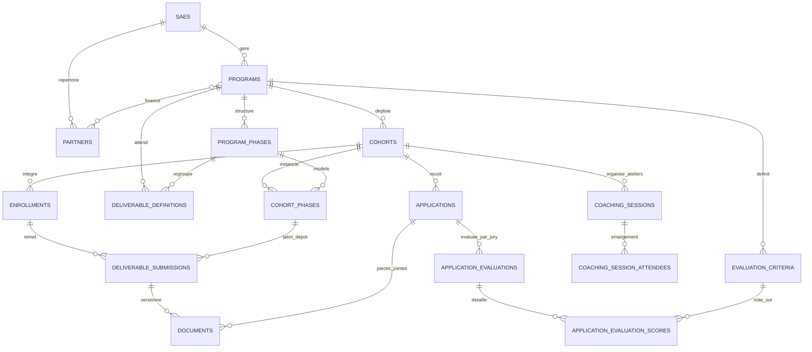

# 🚀 Hubs Africa V2 — Modernisation de l'Architecture d'Accompagnement

> **Document de référence & Synthèse d'ingénierie logicielle**  
> Ce document formalise l'intégration des concepts du référentiel d'accompagnement au sein de l'architecture multi-tenant native de Hubs Africa V2.

---

## 1. Principes Fondamentaux d'Intégration

### 1.1 Respect absolu du Multi-Tenancy SAE
Dans Hubs Africa V2, chaque incubateur / accélérateur (**SAE**) est un tenant isolé. Toute nouvelle entité implémente :
- Le champ `sae_id` avec clé étrangère contrainte vers `saes`.
- Le trait [`BelongsToTenant`](file:///C:/Users/D3vOs/Projets/Javascript(Next_Nuxt_React_VueJs)/Hub_Africa_V2/hubafrica_v2/app/Models/Concerns/BelongsToTenant.php) appliquant automatiquement le global scope `TenantScope` et l'auto-injection du tenant courant.

### 1.2 Conservation de l'Écosystème Existant
- **`Project` & `Entrepreneur` conservés** : Aucun conflit avec les composants Livewire de candidature publique ([`ProgramApplicationWizard`](file:///C:/Users/D3vOs/Projets/Javascript(Next_Nuxt_React_VueJs)/Hub_Africa_V2/hubafrica_v2/app/Livewire/Public/ProgramApplicationWizard.php)) et les espaces entrepreneurs.
- **`Level` conservé** : La nomenclature des niveaux de maturité par SAE reste la référence.
- **`DeliverableDefinition` & `DeliverableSubmission` enrichis** : Raccordement aux phases sans casser l'existant.
- **Distinction claire des Évaluations** :
  - [`Evaluation`](file:///C:/Users/D3vOs/Projets/Javascript(Next_Nuxt_React_VueJs)/Hub_Africa_V2/hubafrica_v2/app/Models/Evaluation.php) : Évaluation des livrables déposés par les startups.
  - `ApplicationEvaluation` : Grille de sélection des jurys sur les dossiers de candidature.

---

## 2. Matrice Comparative : Évolution du Schéma

| Domaine | Schéma Initial Hubs Africa V2 | Proposition brute du Markdown | Solution Adoptée dans Hubs Africa V2 |
| :--- | :--- | :--- | :--- |
| **Phases & Jalons** | Aucun jalon intermédiaire dans le programme | `PhaseTemplate` & `CohortPhase` (sans multi-tenant) | `ProgramPhase` & `CohortPhase` avec `sae_id`, durée estimée, critères de passage et synchronisation intelligente |
| **Notation Candidatures** | Score numérique unique direct sur `Application` | `Evaluation` & `EvaluationScore` (conflit de table) | `EvaluationCriterion` (pondération, max_score) + `ApplicationEvaluation` + `ApplicationEvaluationScore` |
| **Gestion Documentaire** | Stockage direct de chemins de fichiers dans les tables | `Document` polymorphe mono-tenant | `Document` polymorphe versionné (`version`), catégorisé, indexé composite pour haute performance, rattaché à `sae_id` |
| **Partenaires & Financeurs** | Enregistrements de financements ponctuels (`funding_records`) | `Partner` & `partner_program` | Annuaire SAE `Partner` + pivot `partner_program` avec montants, devise et typologie (bailleur, corporate, institutionnel) |
| **Séances de Coaching** | 1-to-1 individuel uniquement | 1-to-1 individuel uniquement | `CoachingSession` supportant l'individuel ET le collectif (par cohorte/phase) avec pointage des présences `coaching_session_attendees` |
| **Indicateurs & Impact** | Table `indicators` statique par SAE | `kpi_indicators` & `kpi_reports` | Conservation de `Indicator` + table de mesures périodiques `indicator_entries` par startup et par cohorte |

---

## 3. Diagramme Entité-Relation Intégré

Toutes les forces du document plateforme-accompagnement-models-migrations.md ont été
  extraites, adaptées et intégrées directement dans l'architecture multi-tenant SAE
  existante de Hubs Africa V2, tout en corrigeant l'intégralité des failles de conception
  relevées lors du challenge.
  Un document d'architecture détaillé a été généré dans l'artéfact
  architecture_accompagnement_hubafrica.md.
  ──────
  ### 🛠️ Ce qui a été conçu et implémenté
  │ Diagram exceeds terminal width (235 > 91 cols)
  │ Displayed as code block. Widen terminal to view inline.
    flowchart TD
        SAE["SAE (Tenant Multi-structure)"] --> PROG["Program"]
        SAE --> PARTNER["Partner (Bailleurs & Sponsors)"]
        PROG --> PP["ProgramPhase (Jalons Templates)"]
        PROG --> CRIT["EvaluationCriterion (Pondérations)"]
        PROG --> COHORT["Cohort (Promotion)"]
        PP -. "Instanciation datée" .-> CP["CohortPhase (Jalons réels)"]
        COHORT --> CP
        COHORT --> APP["Application (Candidatures)"]
        APP --> EVAL["ApplicationEvaluation (Notation Jury)"]
        CRIT --> SCORE["ApplicationEvaluationScore (Notes / Critère)"]
        COHORT --> ENROLL["Enrollment (Startup intégrée)"]
        ENROLL --> SUB["DeliverableSubmission (Livrables)"]
        SUB --> DOCS["Document (GED polymorphe versionnée)"]
        COHORT --> SESS["CoachingSession (Individuel & Collectif)"]
        SESS --> ATT["CoachingSessionAttendee (Émargement)"]
        ENROLL --> KPI["IndicatorEntry (Suivi périodique KPI)"]
  ──────
  ### 1. Les 5 Modules Modernisés

  #### Module 1 : Moteur de Phases Pédagogiques (Template ➔ Instance)

  • Modèles : ProgramPhase & CohortPhase
  • Enum : ProgramPhaseStatus (A_VENIR, EN_COURS, TERMINEE)
  • Résolution de la faille : Les livrables (DeliverableDefinition) et les dépôts
  (DeliverableSubmission) sont désormais rattachables aux phases.
  • Automatisation : Méthode $cohort->syncPhasesFromProgram() qui instancie
  automatiquement les phases du programme avec calcul prévisionnel des dates de début et
  de fin d'après duration_weeks.

  #### Module 2 : Grille d'Évaluation Jury & Scoring Pondéré

  • Modèles : EvaluationCriterion, ApplicationEvaluator, ApplicationEvaluation et
  ApplicationEvaluationScore.
  • Résolution du conflit de nommage : La table existante evaluations (pour les livrables
  de coaching) reste intacte. Le jury dispose de sa propre table dédiée aux candidatures.
  • Résolution de la faille d'attribution : ApplicationEvaluator permet d'affecter
  explicitement les jurys par cohorte ou par candidature.
  • Moteur de calcul : Méthode $evaluation->calculateWeightedScore() qui normalise les
  scores sur 100 en fonction de la pondération de chaque critère et met automatiquement à
  jour la note moyenne consolidée sur Application.

  #### Module 3 : GED Polymorphe Versionnée Haute Performance

  • Modèle : Document
  • Enum : DocumentCategory (CANDIDATURE, LIVRABLE, ADMINISTRATIF, DATAROOM, CONTRAT)
  • Résolution de la faille SQL : Index composite ['documentable_type', 'documentable_id',
  'version'] garantissant un temps de requête instantané pour $model->latestDocument().
  • Raccordé polymorphiquement à DeliverableSubmission, Application, Project et
  Enrollment.

  #### Module 4 : Partenaires, Bailleurs & Contributions

  • Modèle : Partner
  • Enum : PartnerType (BAILLEUR, INSTITUTIONNEL, ENTREPRISE, UNIVERSITE, TECHNIQUE)
  • Pivot : Table partner_program avec rôle du partenaire, montant de contribution et
  devise (XOF par défaut).

  #### Module 5 : Coaching Collectif & Mesure d'Impact Périodique (KPI)

  • Résolution de la faille 1-to-1 : CoachingSession gère désormais les sessions
  collectives (ateliers, masterclasses) associées à une cohorte et à une phase, avec
  feuille d'émargement via CoachingSessionAttendee.
  • Résolution de la faille de suivi temporel : IndicatorEntry permet d'enregistrer
  l'historique d'évolution des métriques (CA, emplois, clients) mois par mois ou
  trimestre par trimestre pour chaque startup.
  ──────
  ### 2. Migrations Exécutées & Seeder de Démonstration

  Les 5 migrations suivantes ont été appliquées avec succès :

  1. 2026_09_28_150001_create_program_phases_and_cohort_phases_tables.php
  2. 2026_09_28_150002_create_evaluation_criteria_and_application_evaluations_tables.php
  3. 2026_09_28_150003_create_documents_table.php
  4. 2026_09_28_150004_create_partners_and_partner_program_tables.php
  5. 2026_09_28_150005_add_collective_sessions_and_indicator_entries_tables.php

  Un seeder complet AccompanimentArchitectureSeeder a été créé et exécuté (php artisan
  db:seed --class=AccompanimentArchitectureSeeder). Il peuple les bailleurs (AFD, GIZ,
  Orange), les 4 phases types, les critères de notation et des relevés d'indicateurs.
  ──────