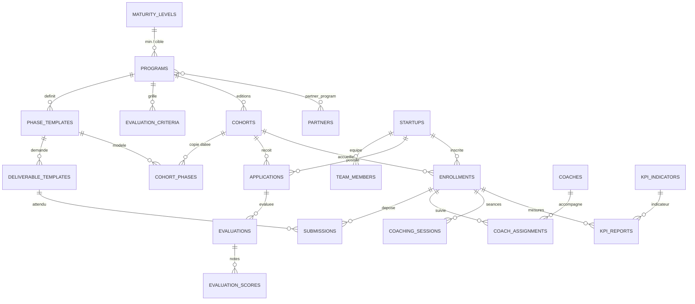

# Plateforme d'accompagnement des startups : modèles et migrations

Base technique : Laravel 11/12, PHP 8.2+, Filament v4 pour le back-office. Ce document couvre l'étape 1 : enums, migrations et modèles Eloquent. Les ressources Filament viendront ensuite.

## 1. Principes de conception

- **Modèle vs instance** : le `Program` définit la structure (`PhaseTemplate`, `DeliverableTemplate`, critères d'évaluation). La `Cohort` en est une édition : elle copie les phases (`CohortPhase`) et leur donne des dates.
- **Demandé vs déposé** : `DeliverableTemplate` = ce qui est demandé. `Submission` = ce qu'une startup a déposé, pour une inscription donnée.
- **Un seul stockage de fichiers** : la table `documents` est polymorphe. Elle sert aux pièces de candidature (`Application`), aux versions de livrables (`Submission`) et aux documents administratifs (`Enrollment`).
- **Niveau (maturité)** : table de référence `maturity_levels`. Le programme définit le niveau minimum requis et le niveau visé ; la startup a un niveau actuel ; l'inscription garde le niveau d'entrée et de sortie.
- **Enums PHP** stockés en `string` (pas d'`enum` SQL, plus simple à faire évoluer).
- **Utilisateurs** : on réutilise la table `users` de Laravel. Les rôles (admin, coach, jury, startup, partenaire) sont à gérer avec `spatie/laravel-permission` ou Filament Shield.
- **Devise par défaut** : `XOF`.
- Les tables de sessions de coaching s'appellent `coaching_sessions` pour ne pas entrer en conflit avec la table `sessions` de Laravel.

## 2. Vue d'ensemble



## 3. Enums

Un fichier par enum dans `app/Enums/`. On pourra plus tard leur faire implémenter `Filament\Support\Contracts\HasLabel` et `HasColor` pour l'affichage dans les ressources Filament.

```php
<?php
// app/Enums/ProgramStage.php
namespace App\Enums;

enum ProgramStage: string
{
    case PreIncubation = 'pre_incubation';
    case Incubation = 'incubation';
    case Acceleration = 'acceleration';
    case Hackathon = 'hackathon';
    case Thematic = 'thematic';
}
```

```php
<?php
// app/Enums/ProgramStatus.php
namespace App\Enums;

enum ProgramStatus: string
{
    case Draft = 'draft';
    case Active = 'active';
    case Archived = 'archived';
}
```

```php
<?php
// app/Enums/ProgramFormat.php
namespace App\Enums;

enum ProgramFormat: string
{
    case Onsite = 'onsite';
    case Hybrid = 'hybrid';
    case Online = 'online';
}
```

```php
<?php
// app/Enums/CohortStatus.php
namespace App\Enums;

enum CohortStatus: string
{
    case Draft = 'draft';
    case ApplicationsOpen = 'applications_open';
    case Selection = 'selection';
    case Running = 'running';
    case Completed = 'completed';
    case Cancelled = 'cancelled';
}
```

```php
<?php
// app/Enums/PhaseStatus.php
namespace App\Enums;

enum PhaseStatus: string
{
    case Upcoming = 'upcoming';
    case Active = 'active';
    case Completed = 'completed';
}
```

```php
<?php
// app/Enums/ApplicationStatus.php
namespace App\Enums;

enum ApplicationStatus: string
{
    case Draft = 'draft';
    case Submitted = 'submitted';
    case UnderReview = 'under_review';
    case Accepted = 'accepted';
    case Waitlisted = 'waitlisted';
    case Rejected = 'rejected';
    case Withdrawn = 'withdrawn';
}
```

```php
<?php
// app/Enums/EnrollmentStatus.php
namespace App\Enums;

enum EnrollmentStatus: string
{
    case Active = 'active';
    case Completed = 'completed';
    case Dropped = 'dropped';
    case Excluded = 'excluded';
}
```

```php
<?php
// app/Enums/DeliverableType.php
namespace App\Enums;

enum DeliverableType: string
{
    case File = 'file';
    case Link = 'link';
    case Text = 'text';
}
```

```php
<?php
// app/Enums/SubmissionStatus.php
namespace App\Enums;

enum SubmissionStatus: string
{
    case Pending = 'pending';
    case Submitted = 'submitted';
    case RevisionRequested = 'revision_requested';
    case Validated = 'validated';
}
```

```php
<?php
// app/Enums/DocumentCategory.php
namespace App\Enums;

enum DocumentCategory: string
{
    case Application = 'application';
    case Deliverable = 'deliverable';
    case Administrative = 'administrative';
}
```

```php
<?php
// app/Enums/CoachType.php
namespace App\Enums;

enum CoachType: string
{
    case Coach = 'coach';
    case Mentor = 'mentor';
    case Expert = 'expert';
    case Trainer = 'trainer';
}
```

```php
<?php
// app/Enums/SessionStatus.php
namespace App\Enums;

enum SessionStatus: string
{
    case Planned = 'planned';
    case Done = 'done';
    case Cancelled = 'cancelled';
    case NoShow = 'no_show';
}
```

## 4. Migrations

Créer les fichiers dans cet ordre (l'ordre des horodatages respecte les dépendances entre clés étrangères). Les horodatages ci-dessous sont des exemples ; adapte-les à la date de création réelle en gardant l'ordre.

### 4.1 `2026_09_28_100001_create_maturity_levels_table.php`

```php
<?php

use Illuminate\Database\Migrations\Migration;
use Illuminate\Database\Schema\Blueprint;
use Illuminate\Support\Facades\Schema;

return new class extends Migration
{
    public function up(): void
    {
        Schema::create('maturity_levels', function (Blueprint $table) {
            $table->id();
            $table->string('code')->unique();
            $table->string('label');
            $table->text('description')->nullable();
            $table->unsignedSmallInteger('position')->default(0);
            $table->timestamps();
        });
    }

    public function down(): void
    {
        Schema::dropIfExists('maturity_levels');
    }
};
```

### 4.2 `2026_09_28_100002_create_partners_table.php`

```php
<?php

use Illuminate\Database\Migrations\Migration;
use Illuminate\Database\Schema\Blueprint;
use Illuminate\Support\Facades\Schema;

return new class extends Migration
{
    public function up(): void
    {
        Schema::create('partners', function (Blueprint $table) {
            $table->id();
            $table->string('name');
            $table->string('type')->nullable();        // bailleur, institution, entreprise, université...
            $table->string('website')->nullable();
            $table->string('contact_name')->nullable();
            $table->string('contact_email')->nullable();
            $table->string('contact_phone')->nullable();
            $table->text('notes')->nullable();
            $table->timestamps();
            $table->softDeletes();
        });
    }

    public function down(): void
    {
        Schema::dropIfExists('partners');
    }
};
```

### 4.3 `2026_09_28_100003_create_programs_table.php`

```php
<?php

use Illuminate\Database\Migrations\Migration;
use Illuminate\Database\Schema\Blueprint;
use Illuminate\Support\Facades\Schema;

return new class extends Migration
{
    public function up(): void
    {
        Schema::create('programs', function (Blueprint $table) {
            $table->id();
            $table->string('name');
            $table->string('slug')->unique();
            $table->string('stage')->index();                  // ProgramStage : niveau visé
            $table->string('status')->default('draft')->index(); // ProgramStatus
            $table->text('summary')->nullable();
            $table->text('objectives')->nullable();
            $table->json('kpi_targets')->nullable();           // objectifs mesurables, ex. {"startups_with_mvp": 20}
            $table->json('sectors')->nullable();
            $table->text('target_profile')->nullable();
            $table->text('eligibility_criteria')->nullable();

            $table->foreignId('min_maturity_level_id')->nullable()
                ->constrained('maturity_levels')->nullOnDelete();
            $table->foreignId('target_maturity_level_id')->nullable()
                ->constrained('maturity_levels')->nullOnDelete();

            $table->unsignedSmallInteger('duration_weeks')->nullable();
            $table->string('format')->default('hybrid');       // ProgramFormat
            $table->json('benefits')->nullable();              // hébergement, subvention, mentorat, accès investisseurs...
            $table->text('conditions')->nullable();            // engagements, règles de sortie

            $table->decimal('budget_amount', 14, 2)->nullable();
            $table->string('currency', 3)->default('XOF');
            $table->decimal('participation_fee', 12, 2)->nullable();
            $table->decimal('equity_percentage', 5, 2)->nullable();

            $table->timestamps();
            $table->softDeletes();
        });
    }

    public function down(): void
    {
        Schema::dropIfExists('programs');
    }
};
```

### 4.4 `2026_09_28_100004_create_partner_program_table.php`

```php
<?php

use Illuminate\Database\Migrations\Migration;
use Illuminate\Database\Schema\Blueprint;
use Illuminate\Support\Facades\Schema;

return new class extends Migration
{
    public function up(): void
    {
        Schema::create('partner_program', function (Blueprint $table) {
            $table->id();
            $table->foreignId('program_id')->constrained()->cascadeOnDelete();
            $table->foreignId('partner_id')->constrained()->cascadeOnDelete();
            $table->string('role')->nullable();                // funder, partner, host, technical...
            $table->decimal('contribution_amount', 14, 2)->nullable();
            $table->timestamps();

            $table->unique(['program_id', 'partner_id']);
        });
    }

    public function down(): void
    {
        Schema::dropIfExists('partner_program');
    }
};
```

### 4.5 `2026_09_28_100005_create_phase_templates_table.php`

```php
<?php

use Illuminate\Database\Migrations\Migration;
use Illuminate\Database\Schema\Blueprint;
use Illuminate\Support\Facades\Schema;

return new class extends Migration
{
    public function up(): void
    {
        Schema::create('phase_templates', function (Blueprint $table) {
            $table->id();
            $table->foreignId('program_id')->constrained()->cascadeOnDelete();
            $table->string('name');
            $table->text('description')->nullable();
            $table->text('objectives')->nullable();
            $table->text('passing_criteria')->nullable();      // critères de passage à la phase suivante
            $table->unsignedSmallInteger('position')->default(1);
            $table->unsignedSmallInteger('duration_weeks')->nullable();
            $table->timestamps();

            $table->unique(['program_id', 'position']);
        });
    }

    public function down(): void
    {
        Schema::dropIfExists('phase_templates');
    }
};
```

### 4.6 `2026_09_28_100006_create_deliverable_templates_table.php`

```php
<?php

use Illuminate\Database\Migrations\Migration;
use Illuminate\Database\Schema\Blueprint;
use Illuminate\Support\Facades\Schema;

return new class extends Migration
{
    public function up(): void
    {
        Schema::create('deliverable_templates', function (Blueprint $table) {
            $table->id();
            $table->foreignId('phase_template_id')->constrained()->cascadeOnDelete();
            $table->string('name');
            $table->text('description')->nullable();
            $table->string('type')->default('file');           // DeliverableType
            $table->json('accepted_mimes')->nullable();        // ex. ["application/pdf"]
            $table->unsignedInteger('max_size_kb')->nullable();
            $table->boolean('is_required')->default(true);
            $table->unsignedSmallInteger('position')->default(1);
            $table->timestamps();
        });
    }

    public function down(): void
    {
        Schema::dropIfExists('deliverable_templates');
    }
};
```

### 4.7 `2026_09_28_100007_create_evaluation_criteria_table.php`

```php
<?php

use Illuminate\Database\Migrations\Migration;
use Illuminate\Database\Schema\Blueprint;
use Illuminate\Support\Facades\Schema;

return new class extends Migration
{
    public function up(): void
    {
        Schema::create('evaluation_criteria', function (Blueprint $table) {
            $table->id();
            $table->foreignId('program_id')->constrained()->cascadeOnDelete();
            $table->string('name');
            $table->text('description')->nullable();
            $table->unsignedSmallInteger('weight')->default(1);     // pondération
            $table->unsignedSmallInteger('max_score')->default(10);
            $table->unsignedSmallInteger('position')->default(1);
            $table->timestamps();
        });
    }

    public function down(): void
    {
        Schema::dropIfExists('evaluation_criteria');
    }
};
```

### 4.8 `2026_09_28_100008_create_cohorts_table.php`

```php
<?php

use Illuminate\Database\Migrations\Migration;
use Illuminate\Database\Schema\Blueprint;
use Illuminate\Support\Facades\Schema;

return new class extends Migration
{
    public function up(): void
    {
        Schema::create('cohorts', function (Blueprint $table) {
            $table->id();
            $table->foreignId('program_id')->constrained()->cascadeOnDelete();
            $table->string('name');                            // ex. "Édition 2026"
            $table->string('code')->unique();
            $table->string('status')->default('draft')->index(); // CohortStatus

            $table->dateTime('applications_open_at')->nullable();
            $table->dateTime('applications_close_at')->nullable();
            $table->date('starts_on')->nullable();
            $table->date('ends_on')->nullable();

            $table->unsignedSmallInteger('capacity')->nullable();
            $table->string('location')->nullable();
            $table->string('format')->nullable();              // surcharge éventuelle du format du programme

            $table->timestamps();
            $table->softDeletes();

            $table->unique(['program_id', 'name']);
        });
    }

    public function down(): void
    {
        Schema::dropIfExists('cohorts');
    }
};
```

### 4.9 `2026_09_28_100009_create_cohort_phases_table.php`

```php
<?php

use Illuminate\Database\Migrations\Migration;
use Illuminate\Database\Schema\Blueprint;
use Illuminate\Support\Facades\Schema;

return new class extends Migration
{
    public function up(): void
    {
        Schema::create('cohort_phases', function (Blueprint $table) {
            $table->id();
            $table->foreignId('cohort_id')->constrained()->cascadeOnDelete();
            $table->foreignId('phase_template_id')->constrained()->restrictOnDelete();
            $table->unsignedSmallInteger('position')->default(1);
            $table->date('starts_on')->nullable();
            $table->date('ends_on')->nullable();
            $table->string('status')->default('upcoming');     // PhaseStatus
            $table->timestamps();

            $table->unique(['cohort_id', 'phase_template_id']);
        });
    }

    public function down(): void
    {
        Schema::dropIfExists('cohort_phases');
    }
};
```

### 4.10 `2026_09_28_100010_create_startups_table.php`

```php
<?php

use Illuminate\Database\Migrations\Migration;
use Illuminate\Database\Schema\Blueprint;
use Illuminate\Support\Facades\Schema;

return new class extends Migration
{
    public function up(): void
    {
        Schema::create('startups', function (Blueprint $table) {
            $table->id();
            $table->foreignId('owner_id')->nullable()->constrained('users')->nullOnDelete();
            $table->string('name');
            $table->string('slug')->unique();
            $table->string('tagline')->nullable();
            $table->text('description')->nullable();
            $table->string('sector')->nullable();
            $table->string('legal_status')->nullable();
            $table->boolean('is_formalized')->default(false);
            $table->date('founded_on')->nullable();
            $table->string('country', 2)->default('TG');
            $table->string('city')->nullable();
            $table->string('website')->nullable();
            $table->string('email')->nullable();
            $table->string('phone')->nullable();
            $table->foreignId('current_maturity_level_id')->nullable()
                ->constrained('maturity_levels')->nullOnDelete();
            $table->timestamps();
            $table->softDeletes();
        });
    }

    public function down(): void
    {
        Schema::dropIfExists('startups');
    }
};
```

### 4.11 `2026_09_28_100011_create_team_members_table.php`

```php
<?php

use Illuminate\Database\Migrations\Migration;
use Illuminate\Database\Schema\Blueprint;
use Illuminate\Support\Facades\Schema;

return new class extends Migration
{
    public function up(): void
    {
        Schema::create('team_members', function (Blueprint $table) {
            $table->id();
            $table->foreignId('startup_id')->constrained()->cascadeOnDelete();
            $table->foreignId('user_id')->nullable()->constrained()->nullOnDelete();
            $table->string('name');
            $table->string('email')->nullable();
            $table->string('phone')->nullable();
            $table->string('role')->nullable();                // CEO, CTO...
            $table->boolean('is_founder')->default(false);
            $table->string('gender', 10)->nullable();          // optionnel : indicateurs d'inclusion (donnée personnelle)
            $table->timestamps();
        });
    }

    public function down(): void
    {
        Schema::dropIfExists('team_members');
    }
};
```

### 4.12 `2026_09_28_100012_create_applications_table.php`

```php
<?php

use Illuminate\Database\Migrations\Migration;
use Illuminate\Database\Schema\Blueprint;
use Illuminate\Support\Facades\Schema;

return new class extends Migration
{
    public function up(): void
    {
        Schema::create('applications', function (Blueprint $table) {
            $table->id();
            $table->foreignId('startup_id')->constrained()->cascadeOnDelete();
            $table->foreignId('cohort_id')->constrained()->cascadeOnDelete();
            $table->string('status')->default('draft')->index(); // ApplicationStatus
            $table->json('answers')->nullable();                 // réponses au formulaire dynamique
            $table->dateTime('submitted_at')->nullable();

            $table->decimal('total_score', 6, 2)->nullable();    // score agrégé des évaluations
            $table->foreignId('decided_by')->nullable()->constrained('users')->nullOnDelete();
            $table->dateTime('decided_at')->nullable();
            $table->text('decision_note')->nullable();

            $table->timestamps();

            $table->unique(['startup_id', 'cohort_id']);
        });
    }

    public function down(): void
    {
        Schema::dropIfExists('applications');
    }
};
```

### 4.13 `2026_09_28_100013_create_evaluations_tables.php`

```php
<?php

use Illuminate\Database\Migrations\Migration;
use Illuminate\Database\Schema\Blueprint;
use Illuminate\Support\Facades\Schema;

return new class extends Migration
{
    public function up(): void
    {
        Schema::create('evaluations', function (Blueprint $table) {
            $table->id();
            $table->foreignId('application_id')->constrained()->cascadeOnDelete();
            $table->foreignId('evaluator_id')->constrained('users')->cascadeOnDelete();
            $table->text('comment')->nullable();
            $table->decimal('total_score', 6, 2)->nullable();
            $table->dateTime('submitted_at')->nullable();
            $table->timestamps();

            $table->unique(['application_id', 'evaluator_id']);
        });

        Schema::create('evaluation_scores', function (Blueprint $table) {
            $table->id();
            $table->foreignId('evaluation_id')->constrained()->cascadeOnDelete();
            $table->foreignId('evaluation_criterion_id')->constrained('evaluation_criteria')->cascadeOnDelete();
            $table->decimal('score', 5, 2);
            $table->text('comment')->nullable();
            $table->timestamps();

            $table->unique(['evaluation_id', 'evaluation_criterion_id']);
        });
    }

    public function down(): void
    {
        Schema::dropIfExists('evaluation_scores');
        Schema::dropIfExists('evaluations');
    }
};
```

### 4.14 `2026_09_28_100014_create_enrollments_table.php`

```php
<?php

use Illuminate\Database\Migrations\Migration;
use Illuminate\Database\Schema\Blueprint;
use Illuminate\Support\Facades\Schema;

return new class extends Migration
{
    public function up(): void
    {
        Schema::create('enrollments', function (Blueprint $table) {
            $table->id();
            $table->foreignId('startup_id')->constrained()->cascadeOnDelete();
            $table->foreignId('cohort_id')->constrained()->cascadeOnDelete();
            $table->foreignId('application_id')->nullable()->constrained()->nullOnDelete();
            $table->string('status')->default('active')->index(); // EnrollmentStatus

            $table->foreignId('entry_maturity_level_id')->nullable()
                ->constrained('maturity_levels')->nullOnDelete();
            $table->foreignId('exit_maturity_level_id')->nullable()
                ->constrained('maturity_levels')->nullOnDelete();
            $table->foreignId('current_cohort_phase_id')->nullable()
                ->constrained('cohort_phases')->nullOnDelete();

            $table->dateTime('enrolled_at')->nullable();
            $table->dateTime('completed_at')->nullable();
            $table->text('exit_reason')->nullable();

            $table->timestamps();
            $table->softDeletes();

            $table->unique(['startup_id', 'cohort_id']);
        });
    }

    public function down(): void
    {
        Schema::dropIfExists('enrollments');
    }
};
```

### 4.15 `2026_09_28_100015_create_submissions_table.php`

```php
<?php

use Illuminate\Database\Migrations\Migration;
use Illuminate\Database\Schema\Blueprint;
use Illuminate\Support\Facades\Schema;

return new class extends Migration
{
    public function up(): void
    {
        Schema::create('submissions', function (Blueprint $table) {
            $table->id();
            $table->foreignId('enrollment_id')->constrained()->cascadeOnDelete();
            $table->foreignId('deliverable_template_id')->constrained()->restrictOnDelete();
            $table->foreignId('cohort_phase_id')->constrained()->cascadeOnDelete(); // dénormalisé pour requêtes rapides
            $table->string('status')->default('pending')->index(); // SubmissionStatus
            $table->text('content')->nullable();                    // pour les livrables de type link ou text
            $table->date('due_on')->nullable();
            $table->dateTime('submitted_at')->nullable();
            $table->foreignId('reviewed_by')->nullable()->constrained('users')->nullOnDelete();
            $table->dateTime('reviewed_at')->nullable();
            $table->text('review_comment')->nullable();
            $table->timestamps();

            $table->unique(['enrollment_id', 'deliverable_template_id']);
        });
    }

    public function down(): void
    {
        Schema::dropIfExists('submissions');
    }
};
```

### 4.16 `2026_09_28_100016_create_documents_table.php`

Table unique et polymorphe pour tous les fichiers (candidature, versions de livrables, documents administratifs).

```php
<?php

use Illuminate\Database\Migrations\Migration;
use Illuminate\Database\Schema\Blueprint;
use Illuminate\Support\Facades\Schema;

return new class extends Migration
{
    public function up(): void
    {
        Schema::create('documents', function (Blueprint $table) {
            $table->id();
            $table->morphs('documentable');                    // Application, Submission ou Enrollment
            $table->string('category')->index();               // DocumentCategory
            $table->string('title')->nullable();
            $table->string('disk')->default('local');
            $table->string('path');
            $table->string('original_name');
            $table->string('mime_type')->nullable();
            $table->unsignedBigInteger('size')->nullable();    // octets
            $table->unsignedSmallInteger('version')->default(1);
            $table->foreignId('uploaded_by')->nullable()->constrained('users')->nullOnDelete();
            $table->timestamps();
            $table->softDeletes();
        });
    }

    public function down(): void
    {
        Schema::dropIfExists('documents');
    }
};
```

### 4.17 `2026_09_28_100017_create_coaching_tables.php`

```php
<?php

use Illuminate\Database\Migrations\Migration;
use Illuminate\Database\Schema\Blueprint;
use Illuminate\Support\Facades\Schema;

return new class extends Migration
{
    public function up(): void
    {
        Schema::create('coaches', function (Blueprint $table) {
            $table->id();
            $table->foreignId('user_id')->unique()->constrained()->cascadeOnDelete();
            $table->string('type')->default('coach');          // CoachType
            $table->text('bio')->nullable();
            $table->json('expertise')->nullable();
            $table->boolean('is_active')->default(true);
            $table->timestamps();
        });

        Schema::create('coach_assignments', function (Blueprint $table) {
            $table->id();
            $table->foreignId('enrollment_id')->constrained()->cascadeOnDelete();
            $table->foreignId('coach_id')->constrained('coaches')->cascadeOnDelete();
            $table->string('role')->default('coach');          // coach principal, mentor, expert...
            $table->date('started_on')->nullable();
            $table->date('ended_on')->nullable();
            $table->timestamps();

            $table->unique(['enrollment_id', 'coach_id', 'role']);
        });

        Schema::create('coaching_sessions', function (Blueprint $table) {
            $table->id();
            $table->foreignId('enrollment_id')->constrained()->cascadeOnDelete();
            $table->foreignId('coach_id')->constrained('coaches')->cascadeOnDelete();
            $table->foreignId('cohort_phase_id')->nullable()->constrained()->nullOnDelete();
            $table->dateTime('scheduled_at');
            $table->unsignedSmallInteger('duration_minutes')->default(60);
            $table->string('mode')->nullable();                // ProgramFormat : présentiel, en ligne
            $table->string('location')->nullable();
            $table->string('status')->default('planned')->index(); // SessionStatus
            $table->boolean('attended')->nullable();
            $table->text('summary')->nullable();               // compte rendu
            $table->text('next_steps')->nullable();
            $table->timestamps();
        });
    }

    public function down(): void
    {
        Schema::dropIfExists('coaching_sessions');
        Schema::dropIfExists('coach_assignments');
        Schema::dropIfExists('coaches');
    }
};
```

### 4.18 `2026_09_28_100018_create_kpi_tables.php`

Les indicateurs sont des lignes, pas des colonnes : on ajoute un KPI sans migration.

```php
<?php

use Illuminate\Database\Migrations\Migration;
use Illuminate\Database\Schema\Blueprint;
use Illuminate\Support\Facades\Schema;

return new class extends Migration
{
    public function up(): void
    {
        Schema::create('kpi_indicators', function (Blueprint $table) {
            $table->id();
            $table->string('code')->unique();                  // revenue, jobs_created, funds_raised, customers...
            $table->string('name');
            $table->string('unit')->nullable();                // XOF, nombre, %
            $table->text('description')->nullable();
            $table->boolean('is_active')->default(true);
            $table->unsignedSmallInteger('position')->default(0);
            $table->timestamps();
        });

        Schema::create('kpi_reports', function (Blueprint $table) {
            $table->id();
            $table->foreignId('enrollment_id')->constrained()->cascadeOnDelete();
            $table->foreignId('kpi_indicator_id')->constrained('kpi_indicators')->restrictOnDelete();
            $table->date('period_on');                         // premier jour de la période mesurée
            $table->decimal('value', 16, 2);
            $table->text('comment')->nullable();
            $table->foreignId('reported_by')->nullable()->constrained('users')->nullOnDelete();
            $table->foreignId('validated_by')->nullable()->constrained('users')->nullOnDelete();
            $table->dateTime('validated_at')->nullable();
            $table->timestamps();

            $table->unique(['enrollment_id', 'kpi_indicator_id', 'period_on']);
        });
    }

    public function down(): void
    {
        Schema::dropIfExists('kpi_reports');
        Schema::dropIfExists('kpi_indicators');
    }
};
```

## 5. Modèles Eloquent

Chaque fichier va dans `app/Models/` avec `namespace App\Models;`. Les `use` d'Eloquent (`Model`, `HasFactory`, `SoftDeletes`, `BelongsTo`, `HasMany`, etc.) et des enums sont à importer ; ils sont omis ci-dessous pour la lisibilité, sauf cas particulier.

### MaturityLevel

```php
class MaturityLevel extends Model
{
    protected $fillable = ['code', 'label', 'description', 'position'];

    public function startups(): HasMany
    {
        return $this->hasMany(Startup::class, 'current_maturity_level_id');
    }
}
```

### Partner

```php
class Partner extends Model
{
    use SoftDeletes;

    protected $fillable = [
        'name', 'type', 'website', 'contact_name', 'contact_email', 'contact_phone', 'notes',
    ];

    public function programs(): BelongsToMany
    {
        return $this->belongsToMany(Program::class)->withPivot(['role', 'contribution_amount'])->withTimestamps();
    }
}
```

### Program

```php
class Program extends Model
{
    use SoftDeletes;

    protected $fillable = [
        'name', 'slug', 'stage', 'status', 'summary', 'objectives', 'kpi_targets', 'sectors',
        'target_profile', 'eligibility_criteria', 'min_maturity_level_id', 'target_maturity_level_id',
        'duration_weeks', 'format', 'benefits', 'conditions', 'budget_amount', 'currency',
        'participation_fee', 'equity_percentage',
    ];

    protected function casts(): array
    {
        return [
            'stage' => ProgramStage::class,
            'status' => ProgramStatus::class,
            'format' => ProgramFormat::class,
            'kpi_targets' => 'array',
            'sectors' => 'array',
            'benefits' => 'array',
            'budget_amount' => 'decimal:2',
            'participation_fee' => 'decimal:2',
            'equity_percentage' => 'decimal:2',
        ];
    }

    public function minMaturityLevel(): BelongsTo
    {
        return $this->belongsTo(MaturityLevel::class, 'min_maturity_level_id');
    }

    public function targetMaturityLevel(): BelongsTo
    {
        return $this->belongsTo(MaturityLevel::class, 'target_maturity_level_id');
    }

    public function partners(): BelongsToMany
    {
        return $this->belongsToMany(Partner::class)->withPivot(['role', 'contribution_amount'])->withTimestamps();
    }

    public function phaseTemplates(): HasMany
    {
        return $this->hasMany(PhaseTemplate::class)->orderBy('position');
    }

    public function evaluationCriteria(): HasMany
    {
        return $this->hasMany(EvaluationCriterion::class)->orderBy('position');
    }

    public function cohorts(): HasMany
    {
        return $this->hasMany(Cohort::class);
    }
}
```

### PhaseTemplate

```php
class PhaseTemplate extends Model
{
    protected $fillable = [
        'program_id', 'name', 'description', 'objectives', 'passing_criteria', 'position', 'duration_weeks',
    ];

    public function program(): BelongsTo
    {
        return $this->belongsTo(Program::class);
    }

    public function deliverableTemplates(): HasMany
    {
        return $this->hasMany(DeliverableTemplate::class)->orderBy('position');
    }
}
```

### DeliverableTemplate

```php
class DeliverableTemplate extends Model
{
    protected $fillable = [
        'phase_template_id', 'name', 'description', 'type', 'accepted_mimes',
        'max_size_kb', 'is_required', 'position',
    ];

    protected function casts(): array
    {
        return [
            'type' => DeliverableType::class,
            'accepted_mimes' => 'array',
            'is_required' => 'boolean',
        ];
    }

    public function phaseTemplate(): BelongsTo
    {
        return $this->belongsTo(PhaseTemplate::class);
    }
}
```

### EvaluationCriterion

Laravel déduit la table `evaluation_criterions` par pluralisation : on force le nom de la table.

```php
class EvaluationCriterion extends Model
{
    protected $table = 'evaluation_criteria';

    protected $fillable = ['program_id', 'name', 'description', 'weight', 'max_score', 'position'];

    public function program(): BelongsTo
    {
        return $this->belongsTo(Program::class);
    }
}
```

### Cohort

```php
class Cohort extends Model
{
    use SoftDeletes;

    protected $fillable = [
        'program_id', 'name', 'code', 'status', 'applications_open_at', 'applications_close_at',
        'starts_on', 'ends_on', 'capacity', 'location', 'format',
    ];

    protected function casts(): array
    {
        return [
            'status' => CohortStatus::class,
            'format' => ProgramFormat::class,
            'applications_open_at' => 'datetime',
            'applications_close_at' => 'datetime',
            'starts_on' => 'date',
            'ends_on' => 'date',
        ];
    }

    public function program(): BelongsTo
    {
        return $this->belongsTo(Program::class);
    }

    public function cohortPhases(): HasMany
    {
        return $this->hasMany(CohortPhase::class)->orderBy('position');
    }

    public function applications(): HasMany
    {
        return $this->hasMany(Application::class);
    }

    public function enrollments(): HasMany
    {
        return $this->hasMany(Enrollment::class);
    }

    /**
     * Copie les phases du programme dans la cohorte (à appeler à la création).
     * Idempotent : ne recrée pas une phase déjà copiée.
     */
    public function syncPhasesFromProgram(): void
    {
        foreach ($this->program->phaseTemplates as $template) {
            $this->cohortPhases()->firstOrCreate(
                ['phase_template_id' => $template->id],
                ['position' => $template->position],
            );
        }
    }
}
```

### CohortPhase

```php
class CohortPhase extends Model
{
    protected $fillable = ['cohort_id', 'phase_template_id', 'position', 'starts_on', 'ends_on', 'status'];

    protected function casts(): array
    {
        return [
            'status' => PhaseStatus::class,
            'starts_on' => 'date',
            'ends_on' => 'date',
        ];
    }

    public function cohort(): BelongsTo
    {
        return $this->belongsTo(Cohort::class);
    }

    public function phaseTemplate(): BelongsTo
    {
        return $this->belongsTo(PhaseTemplate::class);
    }

    public function submissions(): HasMany
    {
        return $this->hasMany(Submission::class);
    }
}
```

### Startup

```php
class Startup extends Model
{
    use SoftDeletes;

    protected $fillable = [
        'owner_id', 'name', 'slug', 'tagline', 'description', 'sector', 'legal_status', 'is_formalized',
        'founded_on', 'country', 'city', 'website', 'email', 'phone', 'current_maturity_level_id',
    ];

    protected function casts(): array
    {
        return [
            'is_formalized' => 'boolean',
            'founded_on' => 'date',
        ];
    }

    public function owner(): BelongsTo
    {
        return $this->belongsTo(User::class, 'owner_id');
    }

    public function maturityLevel(): BelongsTo
    {
        return $this->belongsTo(MaturityLevel::class, 'current_maturity_level_id');
    }

    public function teamMembers(): HasMany
    {
        return $this->hasMany(TeamMember::class);
    }

    public function applications(): HasMany
    {
        return $this->hasMany(Application::class);
    }

    public function enrollments(): HasMany
    {
        return $this->hasMany(Enrollment::class);
    }
}
```

### TeamMember

```php
class TeamMember extends Model
{
    protected $fillable = ['startup_id', 'user_id', 'name', 'email', 'phone', 'role', 'is_founder', 'gender'];

    protected function casts(): array
    {
        return ['is_founder' => 'boolean'];
    }

    public function startup(): BelongsTo
    {
        return $this->belongsTo(Startup::class);
    }

    public function user(): BelongsTo
    {
        return $this->belongsTo(User::class);
    }
}
```

### Application

```php
class Application extends Model
{
    protected $fillable = [
        'startup_id', 'cohort_id', 'status', 'answers', 'submitted_at', 'total_score',
        'decided_by', 'decided_at', 'decision_note',
    ];

    protected function casts(): array
    {
        return [
            'status' => ApplicationStatus::class,
            'answers' => 'array',
            'submitted_at' => 'datetime',
            'decided_at' => 'datetime',
            'total_score' => 'decimal:2',
        ];
    }

    public function startup(): BelongsTo
    {
        return $this->belongsTo(Startup::class);
    }

    public function cohort(): BelongsTo
    {
        return $this->belongsTo(Cohort::class);
    }

    public function decider(): BelongsTo
    {
        return $this->belongsTo(User::class, 'decided_by');
    }

    public function evaluations(): HasMany
    {
        return $this->hasMany(Evaluation::class);
    }

    public function documents(): MorphMany
    {
        return $this->morphMany(Document::class, 'documentable');
    }

    public function enrollment(): HasOne
    {
        return $this->hasOne(Enrollment::class);
    }
}
```

### Evaluation

```php
class Evaluation extends Model
{
    protected $fillable = ['application_id', 'evaluator_id', 'comment', 'total_score', 'submitted_at'];

    protected function casts(): array
    {
        return [
            'total_score' => 'decimal:2',
            'submitted_at' => 'datetime',
        ];
    }

    public function application(): BelongsTo
    {
        return $this->belongsTo(Application::class);
    }

    public function evaluator(): BelongsTo
    {
        return $this->belongsTo(User::class, 'evaluator_id');
    }

    public function scores(): HasMany
    {
        return $this->hasMany(EvaluationScore::class);
    }
}
```

### EvaluationScore

```php
class EvaluationScore extends Model
{
    protected $fillable = ['evaluation_id', 'evaluation_criterion_id', 'score', 'comment'];

    protected function casts(): array
    {
        return ['score' => 'decimal:2'];
    }

    public function evaluation(): BelongsTo
    {
        return $this->belongsTo(Evaluation::class);
    }

    public function criterion(): BelongsTo
    {
        return $this->belongsTo(EvaluationCriterion::class, 'evaluation_criterion_id');
    }
}
```

### Enrollment

```php
class Enrollment extends Model
{
    use SoftDeletes;

    protected $fillable = [
        'startup_id', 'cohort_id', 'application_id', 'status', 'entry_maturity_level_id',
        'exit_maturity_level_id', 'current_cohort_phase_id', 'enrolled_at', 'completed_at', 'exit_reason',
    ];

    protected function casts(): array
    {
        return [
            'status' => EnrollmentStatus::class,
            'enrolled_at' => 'datetime',
            'completed_at' => 'datetime',
        ];
    }

    public function startup(): BelongsTo
    {
        return $this->belongsTo(Startup::class);
    }

    public function cohort(): BelongsTo
    {
        return $this->belongsTo(Cohort::class);
    }

    public function application(): BelongsTo
    {
        return $this->belongsTo(Application::class);
    }

    public function entryMaturityLevel(): BelongsTo
    {
        return $this->belongsTo(MaturityLevel::class, 'entry_maturity_level_id');
    }

    public function exitMaturityLevel(): BelongsTo
    {
        return $this->belongsTo(MaturityLevel::class, 'exit_maturity_level_id');
    }

    public function currentPhase(): BelongsTo
    {
        return $this->belongsTo(CohortPhase::class, 'current_cohort_phase_id');
    }

    public function submissions(): HasMany
    {
        return $this->hasMany(Submission::class);
    }

    public function coachAssignments(): HasMany
    {
        return $this->hasMany(CoachAssignment::class);
    }

    public function coachingSessions(): HasMany
    {
        return $this->hasMany(CoachingSession::class);
    }

    public function kpiReports(): HasMany
    {
        return $this->hasMany(KpiReport::class);
    }

    public function documents(): MorphMany
    {
        return $this->morphMany(Document::class, 'documentable');
    }

    /**
     * Crée une ligne "pending" pour chaque livrable attendu dans la cohorte,
     * afin de pouvoir suivre ce qui manque et déclencher des relances.
     * Idempotent.
     */
    public function generateSubmissions(): void
    {
        $phases = $this->cohort->cohortPhases()
            ->with('phaseTemplate.deliverableTemplates')
            ->get();

        foreach ($phases as $phase) {
            foreach ($phase->phaseTemplate->deliverableTemplates as $deliverable) {
                $this->submissions()->firstOrCreate(
                    ['deliverable_template_id' => $deliverable->id],
                    ['cohort_phase_id' => $phase->id, 'due_on' => $phase->ends_on],
                );
            }
        }
    }
}
```

### Submission

```php
class Submission extends Model
{
    protected $fillable = [
        'enrollment_id', 'deliverable_template_id', 'cohort_phase_id', 'status', 'content',
        'due_on', 'submitted_at', 'reviewed_by', 'reviewed_at', 'review_comment',
    ];

    protected function casts(): array
    {
        return [
            'status' => SubmissionStatus::class,
            'due_on' => 'date',
            'submitted_at' => 'datetime',
            'reviewed_at' => 'datetime',
        ];
    }

    public function enrollment(): BelongsTo
    {
        return $this->belongsTo(Enrollment::class);
    }

    public function deliverableTemplate(): BelongsTo
    {
        return $this->belongsTo(DeliverableTemplate::class);
    }

    public function cohortPhase(): BelongsTo
    {
        return $this->belongsTo(CohortPhase::class);
    }

    public function reviewer(): BelongsTo
    {
        return $this->belongsTo(User::class, 'reviewed_by');
    }

    /** Toutes les versions déposées. */
    public function documents(): MorphMany
    {
        return $this->morphMany(Document::class, 'documentable')->orderByDesc('version');
    }

    /** Dernière version déposée. */
    public function latestDocument(): MorphOne
    {
        return $this->morphOne(Document::class, 'documentable')->latestOfMany('version');
    }

    public function isOverdue(): bool
    {
        return $this->due_on
            && $this->due_on->isPast()
            && in_array($this->status, [SubmissionStatus::Pending, SubmissionStatus::RevisionRequested], true);
    }
}
```

### Document

```php
class Document extends Model
{
    use SoftDeletes;

    protected $fillable = [
        'documentable_type', 'documentable_id', 'category', 'title', 'disk', 'path',
        'original_name', 'mime_type', 'size', 'version', 'uploaded_by',
    ];

    protected function casts(): array
    {
        return ['category' => DocumentCategory::class];
    }

    public function documentable(): MorphTo
    {
        return $this->morphTo();
    }

    public function uploader(): BelongsTo
    {
        return $this->belongsTo(User::class, 'uploaded_by');
    }
}
```

### Coach

```php
class Coach extends Model
{
    protected $fillable = ['user_id', 'type', 'bio', 'expertise', 'is_active'];

    protected function casts(): array
    {
        return [
            'type' => CoachType::class,
            'expertise' => 'array',
            'is_active' => 'boolean',
        ];
    }

    public function user(): BelongsTo
    {
        return $this->belongsTo(User::class);
    }

    public function assignments(): HasMany
    {
        return $this->hasMany(CoachAssignment::class);
    }

    public function sessions(): HasMany
    {
        return $this->hasMany(CoachingSession::class);
    }
}
```

### CoachAssignment

```php
class CoachAssignment extends Model
{
    protected $fillable = ['enrollment_id', 'coach_id', 'role', 'started_on', 'ended_on'];

    protected function casts(): array
    {
        return [
            'started_on' => 'date',
            'ended_on' => 'date',
        ];
    }

    public function enrollment(): BelongsTo
    {
        return $this->belongsTo(Enrollment::class);
    }

    public function coach(): BelongsTo
    {
        return $this->belongsTo(Coach::class);
    }
}
```

### CoachingSession

```php
class CoachingSession extends Model
{
    protected $fillable = [
        'enrollment_id', 'coach_id', 'cohort_phase_id', 'scheduled_at', 'duration_minutes',
        'mode', 'location', 'status', 'attended', 'summary', 'next_steps',
    ];

    protected function casts(): array
    {
        return [
            'status' => SessionStatus::class,
            'mode' => ProgramFormat::class,
            'scheduled_at' => 'datetime',
            'attended' => 'boolean',
        ];
    }

    public function enrollment(): BelongsTo
    {
        return $this->belongsTo(Enrollment::class);
    }

    public function coach(): BelongsTo
    {
        return $this->belongsTo(Coach::class);
    }

    public function cohortPhase(): BelongsTo
    {
        return $this->belongsTo(CohortPhase::class);
    }
}
```

### KpiIndicator

```php
class KpiIndicator extends Model
{
    protected $fillable = ['code', 'name', 'unit', 'description', 'is_active', 'position'];

    protected function casts(): array
    {
        return ['is_active' => 'boolean'];
    }

    public function reports(): HasMany
    {
        return $this->hasMany(KpiReport::class);
    }
}
```

### KpiReport

```php
class KpiReport extends Model
{
    protected $fillable = [
        'enrollment_id', 'kpi_indicator_id', 'period_on', 'value', 'comment',
        'reported_by', 'validated_by', 'validated_at',
    ];

    protected function casts(): array
    {
        return [
            'period_on' => 'date',
            'value' => 'decimal:2',
            'validated_at' => 'datetime',
        ];
    }

    public function enrollment(): BelongsTo
    {
        return $this->belongsTo(Enrollment::class);
    }

    public function indicator(): BelongsTo
    {
        return $this->belongsTo(KpiIndicator::class, 'kpi_indicator_id');
    }

    public function reporter(): BelongsTo
    {
        return $this->belongsTo(User::class, 'reported_by');
    }

    public function validator(): BelongsTo
    {
        return $this->belongsTo(User::class, 'validated_by');
    }
}
```

## 6. Seeders de référence

À placer dans `database/seeders/`. À adapter à ton propre référentiel de maturité.

```php
<?php

namespace Database\Seeders;

use App\Models\KpiIndicator;
use App\Models\MaturityLevel;
use Illuminate\Database\Seeder;

class ReferenceDataSeeder extends Seeder
{
    public function run(): void
    {
        $levels = [
            ['idea', 'Idée', 'Concept identifié, pas encore de prototype.'],
            ['prototype', 'Prototype', 'Première version testable en interne.'],
            ['mvp', 'MVP', 'Produit minimal utilisable par de vrais utilisateurs.'],
            ['traction', 'Traction', 'Premiers clients ou utilisateurs réguliers.'],
            ['growth', 'Croissance', 'Modèle validé, phase de passage à l\'échelle.'],
        ];

        foreach ($levels as $i => [$code, $label, $description]) {
            MaturityLevel::updateOrCreate(
                ['code' => $code],
                ['label' => $label, 'description' => $description, 'position' => $i + 1],
            );
        }

        $kpis = [
            ['revenue', 'Chiffre d\'affaires', 'XOF'],
            ['customers', 'Clients ou utilisateurs actifs', 'nombre'],
            ['jobs_created', 'Emplois créés', 'nombre'],
            ['funds_raised', 'Fonds levés', 'XOF'],
        ];

        foreach ($kpis as $i => [$code, $name, $unit]) {
            KpiIndicator::updateOrCreate(
                ['code' => $code],
                ['name' => $name, 'unit' => $unit, 'position' => $i + 1],
            );
        }
    }
}
```

## 7. Ordre d'exécution

```bash
# 1. Créer les enums, migrations et modèles comme indiqué ci-dessus
# 2. Lancer les migrations
php artisan migrate

# 3. Charger les données de référence
php artisan db:seed --class=ReferenceDataSeeder
```

## 8. Points d'attention

- **Copie des phases** : appeler `$cohort->syncPhasesFromProgram()` à la création d'une cohorte (observer ou action Filament `afterCreate`), puis ajuster les dates dans `cohort_phases`.
- **Création des livrables attendus** : appeler `$enrollment->generateSubmissions()` quand une candidature est acceptée et l'inscription créée.
- **Versions de fichiers** : à chaque nouveau dépôt, créer un `Document` avec `version = max(version) + 1` sur la `Submission` concernée, puis passer la soumission en `submitted`.
- **Score de candidature** : calculer `evaluations.total_score` (somme pondérée des `evaluation_scores`) puis la moyenne dans `applications.total_score`, par exemple dans un observer d'`EvaluationScore`.
- **Données personnelles** : `team_members.gender` est facultatif. Ne le garde que si tes bailleurs l'exigent pour les indicateurs d'inclusion, et sépare bien les documents de candidats non retenus (durée de conservation limitée).
- **Multi-structures** : si plusieurs SAE doivent utiliser l'outil, ajoute dès maintenant un `organization_id` sur `programs`, `partners`, `startups` (ou `coaches`) et un scope global. C'est beaucoup plus coûteux à ajouter après coup.
- **Hors périmètre de cette étape** : événements et ateliers, notifications, messagerie, portail partenaires. Ils viendront avec les ressources Filament.

## 9. Suite proposée

1. Ressources Filament : `ProgramResource` (avec gestionnaires de relations pour phases, livrables, critères), `CohortResource`, `ApplicationResource` (grille d'évaluation).
2. Panel séparé pour les startups (candidature, dépôt de livrables, KPI).
3. Panel coachs (séances, comptes rendus).
4. Dashboards de suivi par cohorte et par bailleur.
